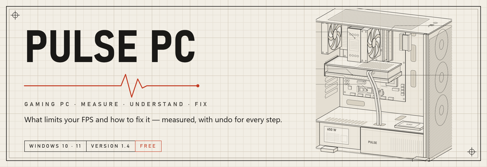
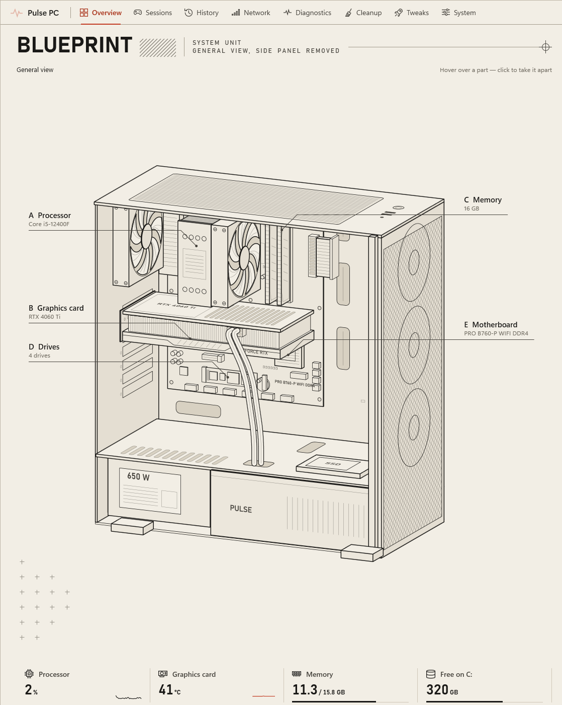
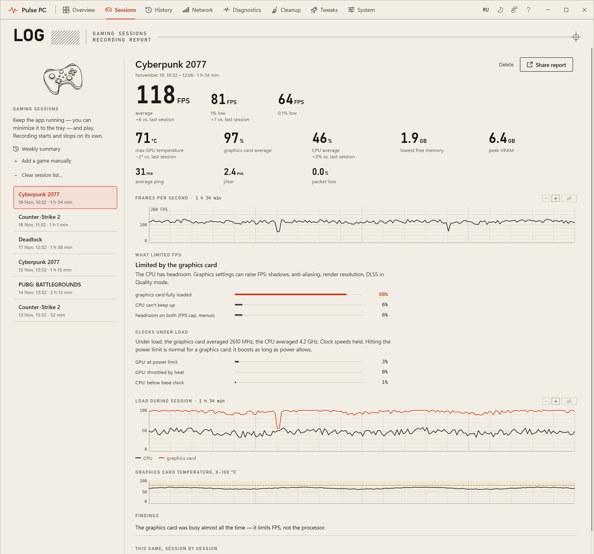
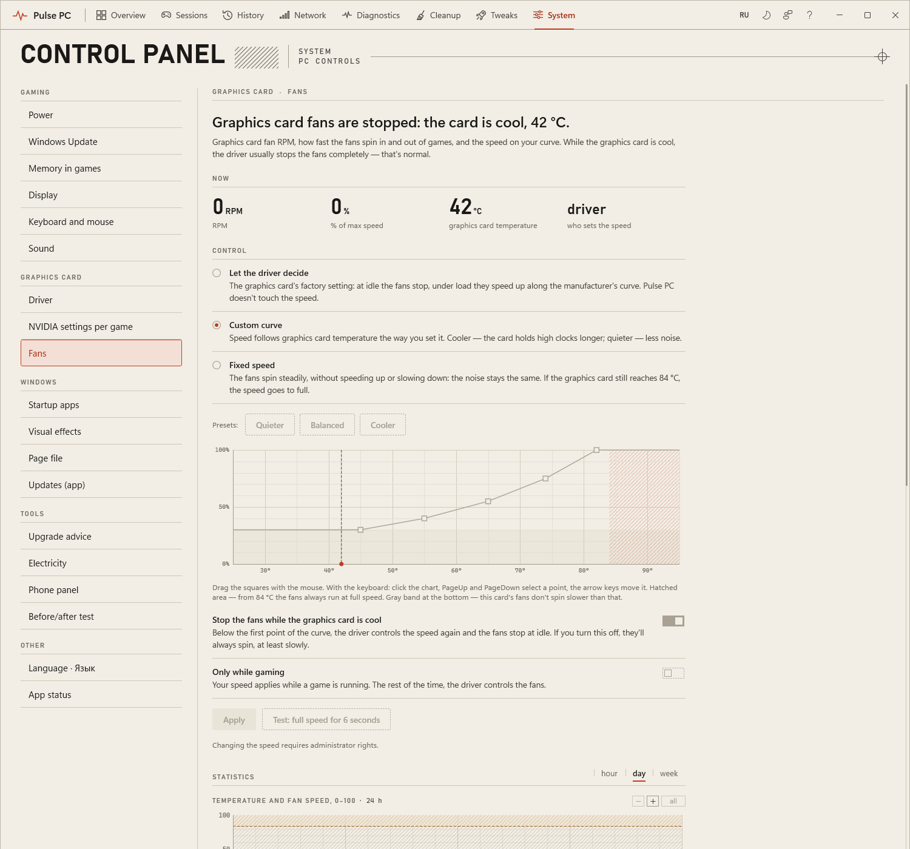
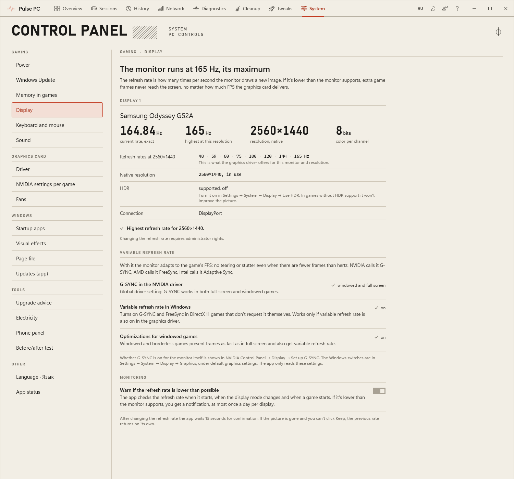
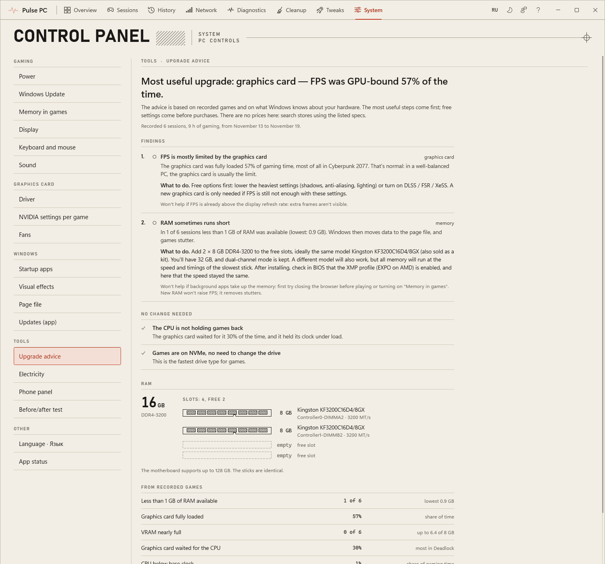
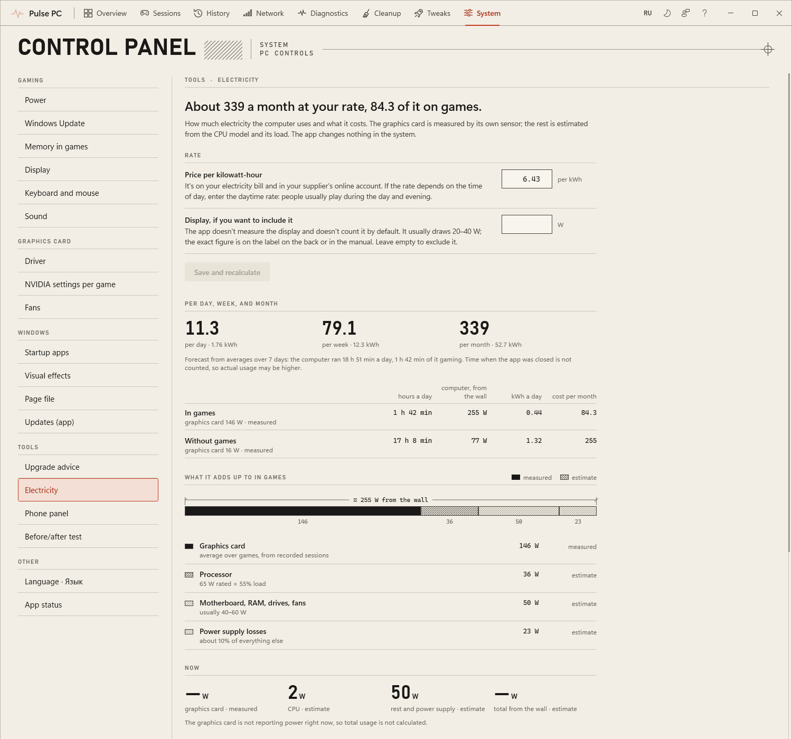

<p align="center">
  <a href="README.md">Русский</a>&nbsp;&nbsp;·&nbsp;&nbsp;<b>English</b>
</p>

<p align="center">
  
</p>

<p align="center">
  <a href="https://github.com/Arman715/pulse-pc/releases/latest"></a>
  <a href="https://github.com/Arman715/pulse-pc/releases"></a>
  
  
  <a href="LICENSE"></a>
  <a href="https://www.instagram.com/pulsepc_official/"></a>
</p>

<h3 align="center">
  <a href="https://github.com/Arman715/pulse-pc/releases/latest">⬇&nbsp;Download the installer</a>
  &nbsp;&nbsp;·&nbsp;&nbsp;
  <a href="docs/guide.en.md">📖&nbsp;User guide</a>
  &nbsp;&nbsp;·&nbsp;&nbsp;
  <a href="https://www.instagram.com/pulsepc_official/">📷&nbsp;Instagram</a>
</h3>

<p align="center">
  Pulse PC watches your computer while you play, and after the game it tells you in plain words<br>
  what limited your FPS, where the stutters came from and what to do about it. Every change can be undone.<br>
  Free and <a href="#open-source">open source</a>. The interface is in English and Russian.
</p>

---

## Get started in three steps

| # | What to do | How |
|:-:|---|---|
| **1** | **Download and install** | [PulsePC-Setup.exe](https://github.com/Arman715/pulse-pc/releases/latest) → **Install**. Tick **Start with Windows, minimized to the tray** so no game is ever missed. |
| **2** | **Just play** | The app notices the game and starts recording on its own. You can close the window — it keeps working in the tray. |
| **3** | **Open the report** | After the game you get a **Session recorded** notification. The **Sessions** tab shows FPS, stutters, their causes — and what to do about them. |

The full walkthrough, with pictures and a glossary, is in the **[user guide](docs/guide.en.md)**. Inside the app, help opens with the **?** button or **F1**.

### Who it's for

- **The game lags and you don't know why.** Pulse PC shows what holds it back: graphics card, processor, memory, drive or network.
- **You want more FPS but are afraid of "breaking Windows".** Every setting is explained, and every one has **Restore previous**.
- **You're thinking about an upgrade.** The advice is based on your own games: what to buy and what isn't worth replacing.

---

## Your PC as a blueprint



The main screen is a blueprint of your PC, drawn from what is actually inside: processor, graphics card, every memory stick and every drive.
Click a part and it comes apart, with a label on each piece saying how it is working right now.

- Load, clocks, GPU temperature and memory — live.
- Drive health, driver errors and Windows crashes — on the **Diagnostics** tab.
- How much space can be freed, and a cleanup with a clear list of what goes.

<br clear="right">

## A report after every game

<p align="center"></p>

Recording starts by itself when a game launches and stops when it closes. The report shows:

| | |
|---|---|
| **FPS** | average, worst 1 % and 0.1 % of frames, and a graph of the whole session |
| **What limited FPS** | graphics card, processor or a frame cap — and what helps in exactly this case |
| **Drops** | when they happened and why: low memory, the drive, clock throttling, heat |
| **Network** | ping to the game server, jitter and packet loss |
| **Comparison** | the same game, session after session |

## Settings that used to hide in the corners of Windows

<table>
<tr>
<td width="50%"></td>
<td width="50%"></td>
</tr>
<tr>
<td><b>Graphics card fans.</b> Your own speed curve, quieter or cooler, a weekly history and a reminder to clean out the dust. From&nbsp;84&nbsp;°C the fans always run at full speed.</td>
<td><b>Display.</b> Is your monitor running at its real refresh rate — 144 or 165&nbsp;Hz, not 60? G-SYNC, HDR, the connector. If the rate gets reset, the app warns you.</td>
</tr>
<tr>
<td width="50%"></td>
<td width="50%"></td>
</tr>
<tr>
<td><b>Upgrade advice.</b> Based on your games, not someone else's benchmarks: what will help, what to add and what doesn't need replacing.</td>
<td><b>Electricity.</b> What an hour of gaming and a month of running your PC cost at your own rate.</td>
</tr>
</table>

Also: a power plan just for gaming, Windows Update that stays out of your matches, freeing memory before a game, mouse polling rate, sound,
NVIDIA settings per game, the page file, startup apps, a phone panel on your home network and a before/after test.

## Made to fit you

- **English and Russian, light and dark theme** — the small **EN** and moon buttons in the title bar. By default it follows Windows.
- **A window that fits your screen:** from a 1366×768 laptop to a large monitor. Windows' text size is respected, and the window remembers its size and position.
- **Your own game:** if the app didn't find a game, add its .exe on the **Sessions** tab.
- **Report a problem or leave a review** — a button in the title bar: a description, screenshots and app details go out as an email from your own mailbox.

Like the app? Give it a ⭐ on GitHub — it helps other players find it.

## Installation

1. Download `PulsePC-Setup-<version>.exe` from the [latest release](https://github.com/Arman715/pulse-pc/releases/latest).
2. Run it and click **Install**. The app needs administrator rights: without them Windows doesn't let it read the sensors or change settings.
3. After that, Pulse PC updates itself: **System** → **Updates (app)** → **Update**.

What to do next is in the **[user guide](docs/guide.en.md)**: the first launch, how to read a report, getting ready for a game, cleanup and every section of **System**.

> [!NOTE]
> The installer is not signed with a paid certificate, so SmartScreen may say "Windows protected your PC".
> Click **More info** → **Run anyway**. The SHA-256 checksum sits next to the installer in a `.sha256` file;
> when updating, the app checks it by itself.

## FAQ

<details>
<summary><b>Can I get banned in a game?</b></summary>

The app draws nothing over the game and doesn't inject anything into it. It measures FPS with Intel's official PresentMon tool — the same way
CapFrameX and NVIDIA FrameView do. In games with a kernel-level anti-cheat (VALORANT, League of Legends) frame recording is switched off entirely, just in case.
</details>

<details>
<summary><b>What if a setting makes things worse?</b></summary>

Every change has a **Restore previous** button: the app saves the old values before it changes anything.
Windows security settings — Defender, the firewall, SmartScreen, User Account Control — the app doesn't touch at all.
</details>

<details>
<summary><b>Will it work with my hardware?</b></summary>

Yes: NVIDIA, AMD and Intel graphics cards, Intel and AMD processors, laptops and desktops. Some features are NVIDIA-only —
for example, GPU fan control and per-game driver settings. Where a feature isn't available, the app says so and tells you where to do it instead.
</details>

<details>
<summary><b>What does the app send to the internet?</b></summary>

Nothing about you. It asks NVIDIA for the latest driver version for your graphics card model and checks this repository for new versions. Everything else stays on your PC.
You can verify it: all of the app's code is in the [`src`](src) folder. The app never sends a problem report or a review by itself — it opens an email in your own mail, and you see what's in it.
</details>

<details>
<summary><b>Is there a video?</b></summary>

Yes — a 24-second <a href="https://github.com/Arman715/pulse-pc/raw/main/docs/PulsePC-video.mp4">video about the app</a> (MP4, 19.6 MB). The voice-over is in Russian, but the pictures speak for themselves.
</details>

## Open source

All of Pulse PC's code is in the [`src`](src) folder: the Windows app (C#, WPF, .NET 10) and the iPhone panel ([`src/ios/PulsePhone`](src/ios/PulsePhone), Swift).
You can read exactly what the app does to your system, build it yourself and suggest a fix.

**Build from source.** You need Windows 10/11 and the [.NET 10 SDK](https://dotnet.microsoft.com/download/dotnet/10.0).

```powershell
git clone https://github.com/Arman715/pulse-pc.git
cd pulse-pc\src
.\build.ps1 -Preview   # preview build without administrator rights: changes nothing in the system
.\build.ps1            # full build into src\app (runs with administrator rights)
```

The self-test (setting rollbacks, file deletion, data parsing) runs without changing the system: `PulsePC.exe --selftest`.

**Official releases** are built with [`build-release.ps1`](src/build-release.ps1) and signed with the author's key.
The app installs an update only if the signature is valid — so a copy built by someone else can't pass itself off as a Pulse PC update.

**Found a bug or have an idea?** Open an [issue](https://github.com/Arman715/pulse-pc/issues) — attach the report from **System** → **App status** → **Copy report**.
Send fixes as a pull request: describe what changes and how you tested it. Issues in English or Russian are both welcome.

**License — [GPL-3.0](LICENSE).** You may use, modify and distribute the code, including your own versions,
as long as they are also released under GPL-3.0 with open source code and credit to the author. You can't close the code in your copy.

---

News, "why does my game stutter" breakdowns and answers to questions — on Instagram **[@pulsepc_official](https://www.instagram.com/pulsepc_official/)**.

<sub>© 2026 Arman715. The code is distributed under the <a href="LICENSE">GPL-3.0</a> license.
Includes Intel's <a href="https://github.com/GameTechDev/PresentMon">PresentMon</a> (MIT license, text in <a href="src/third-party/PresentMon/LICENSE.txt">src/third-party/PresentMon</a>). Requires 64-bit Windows 10 or 11.</sub>
