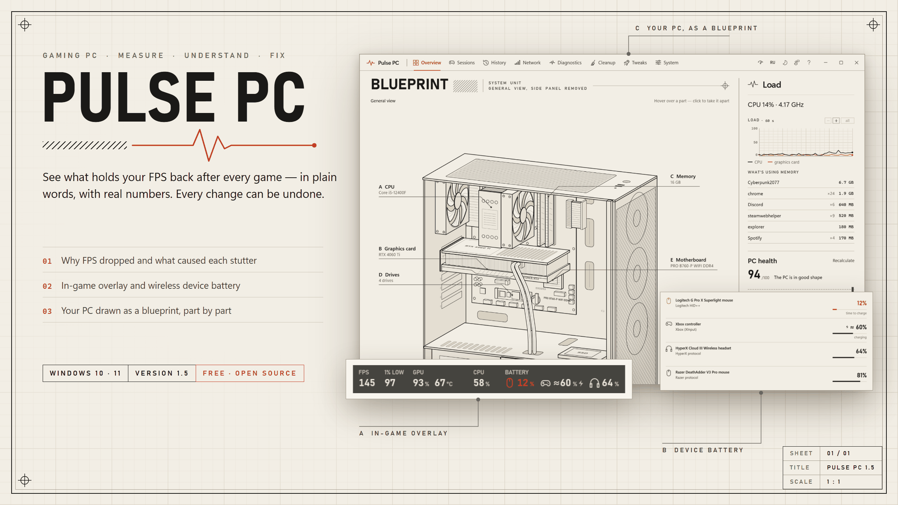
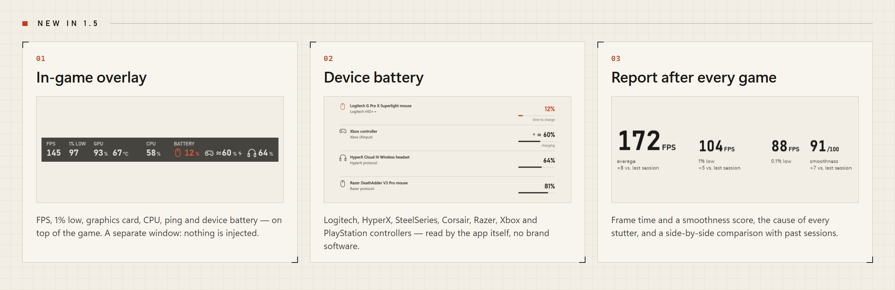
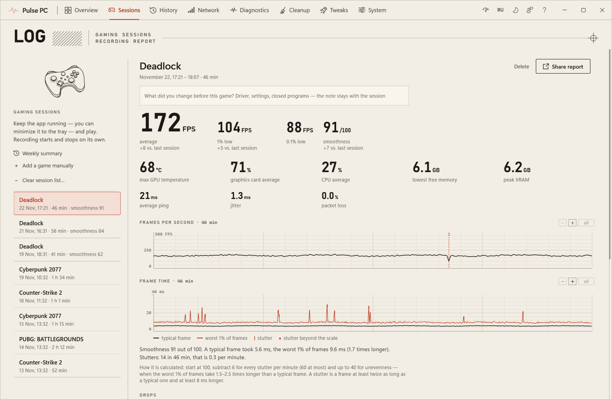
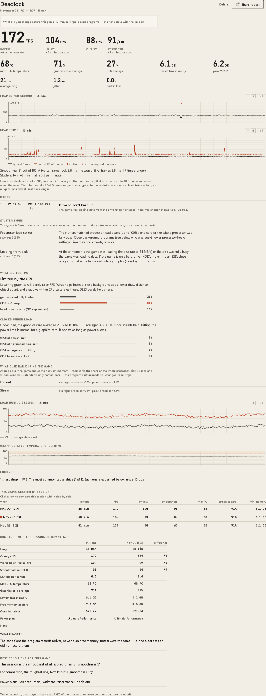
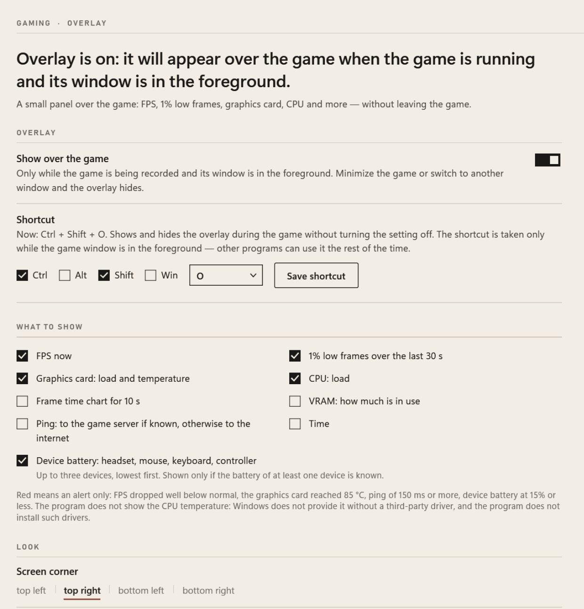
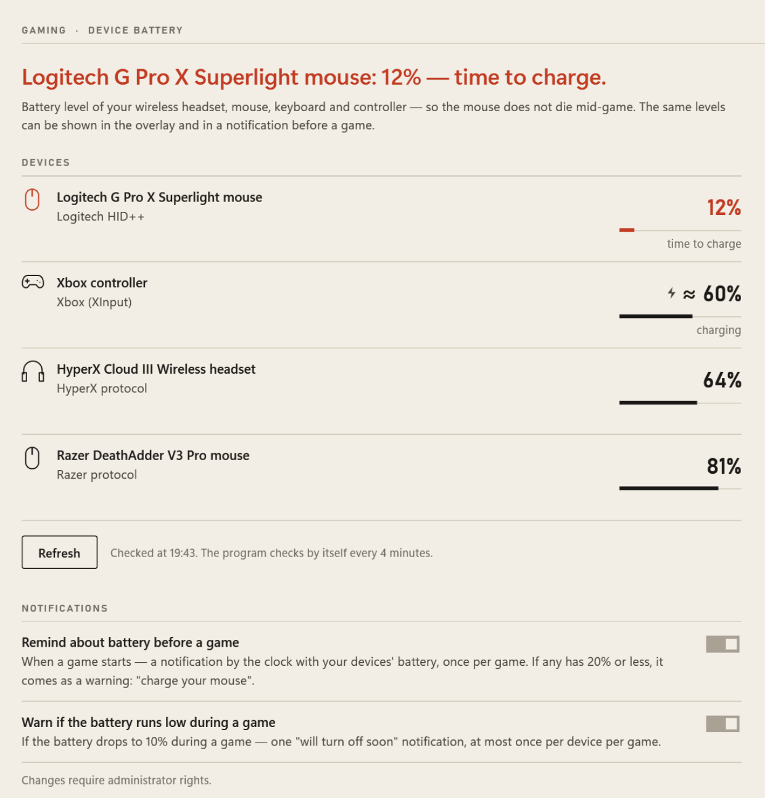
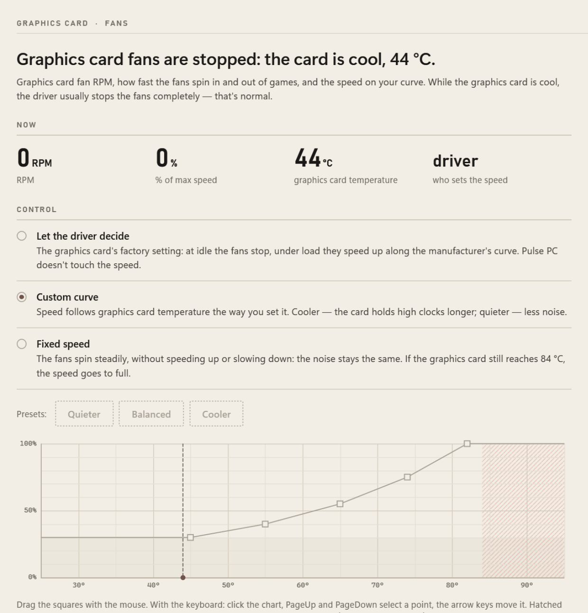
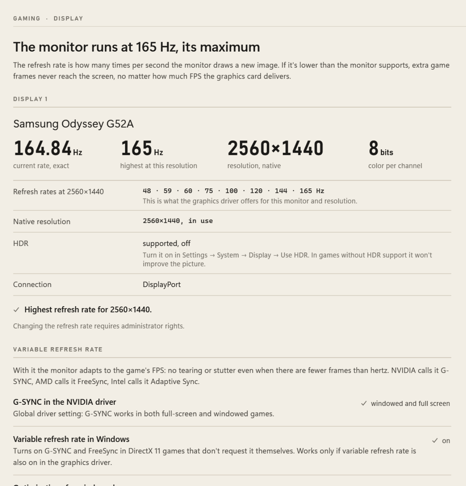
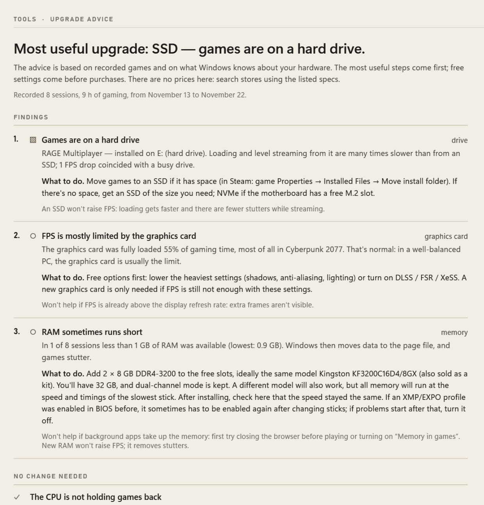
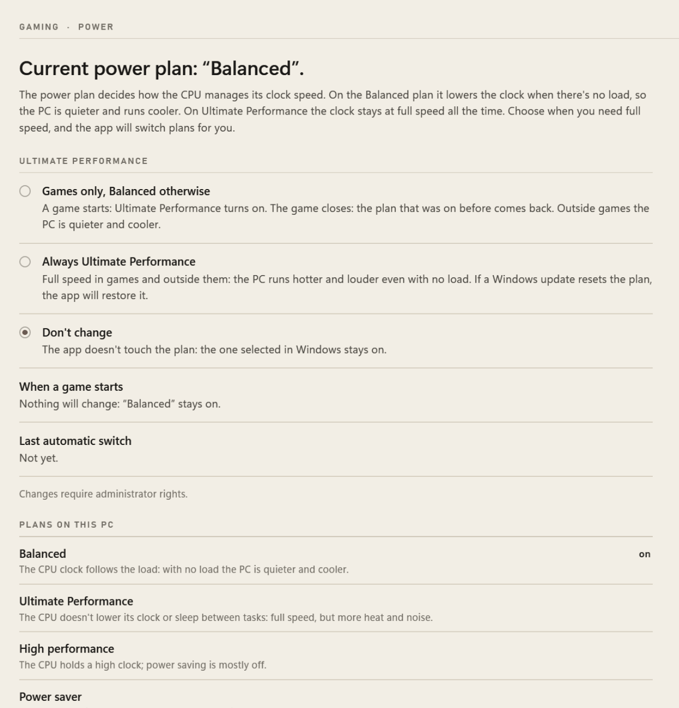

<p align="right"><b>English</b>&nbsp;&nbsp;·&nbsp;&nbsp;<a href="README.ru.md">Русский</a></p>

<p align="center">
<picture>
  <source media="(prefers-color-scheme: dark)" srcset="docs/v15/en/dark/hero.png">
  
</picture>
</p>

<p align="center">
  <a href="https://github.com/Arman715/pulse-pc/releases/latest"></a>
  <a href="https://github.com/Arman715/pulse-pc/releases"></a>
  
  
  <a href="LICENSE"></a>
  <a href="https://www.virustotal.com/gui/file/af24e27fa1aff39391233dce420760c4271ba27b3cf68323c7eb6093f1059ac2"></a>
</p>

<h3 align="center">
  <a href="https://github.com/Arman715/pulse-pc/releases/latest">⬇&nbsp;&nbsp;Download for Windows</a>
  &nbsp;&nbsp;·&nbsp;&nbsp;
  <a href="docs/guide.en.md">User guide</a>
  &nbsp;&nbsp;·&nbsp;&nbsp;
  <a href="https://www.instagram.com/pulsepc_official/">Instagram</a>
</h3>

<p align="center">
  Pulse PC watches your computer while you play. After the game it tells you in plain words<br>
  what held your FPS back, where every stutter came from and what to do about it.<br>
  Every change can be undone. Free and <a href="#open-source">open source</a>, in English and Russian.
</p>

<br>

<picture>
  <source media="(prefers-color-scheme: dark)" srcset="docs/v15/en/dark/new.png">
  
</picture>

**Also in 1.5:** cautious mode for games with a strict anti-cheat (VALORANT, Call of Duty, Genshin Impact and others) — frame and game-server recording is off there;
all your games found by themselves — from stores, from folders and by behavior; memory and XMP/EXPO checks with a risk warning, blue screens in plain words,
WHEA errors and game crashes; Wi‑Fi and ping under load; a **Laptop** section; **Why is it slow right now**; **PC health**; **Installed programs**;
optional automatic updates and a portable version; every problem from the Windows logs comes with **Details and what to do** — the entries in plain words, a step-by-step plan and a button that opens exactly these entries in Event Viewer.

## A report after every game

Recording starts by itself when a game starts and stops when it closes. You can close the window — the app keeps working in the tray.

<picture>
  <source media="(prefers-color-scheme: dark)" srcset="docs/v15/en/dark/sessions.png">
  
</picture>

| | |
|---|---|
| **FPS and frame time** | average, 1% and 0.1% low, a smoothness score out of 100 and every stutter on the timeline |
| **Why it stuttered** | each drop explained: memory, drive, CPU load, heat, power — taken from the sensors at that very second |
| **What limited FPS** | the graphics card, the CPU or a cap — and what will actually help in this case |
| **Network** | ping to the game server, jitter, packet loss and connection gaps |
| **Comparison** | this session next to any earlier one, and the conditions your smoothest game had |

<details>
<summary><b>See a full report</b></summary>
<br>

<picture>
  <source media="(prefers-color-scheme: dark)" srcset="docs/v15/en/dark/report.png">
  
</picture>
</details>

## Overlay and device battery

<table>
<tr>
<td width="50%"><picture>
  <source media="(prefers-color-scheme: dark)" srcset="docs/v15/en/dark/overlay.png">
  
</picture></td>
<td width="50%"><picture>
  <source media="(prefers-color-scheme: dark)" srcset="docs/v15/en/dark/battery.png">
  
</picture></td>
</tr>
<tr>
<td valign="top"><b>Overlay.</b> A small panel on top of the game: FPS, 1% low, graphics card, CPU, VRAM, ping, time and device battery. It's a separate window, so nothing is injected into the game. Visible in "Borderless" and "Fullscreen windowed" modes; <kbd>Ctrl</kbd>+<kbd>Shift</kbd>+<kbd>O</kbd> hides it.</td>
<td valign="top"><b>Device battery.</b> Mice, headsets, keyboards and controllers — Logitech, HyperX, SteelSeries, Corsair, Razer, Xbox, PlayStation, Bluetooth devices and more. The app reads the charge by itself with read-only requests and reminds you before a game if something is about to run out.</td>
</tr>
</table>

## Get started in three steps

| # | What to do | How |
|:-:|---|---|
| **1** | **Download and install** | [PulsePC-Setup.exe](https://github.com/Arman715/pulse-pc/releases/latest) → **Install**. Tick **Start with Windows, minimized to the tray** so no game is ever missed. |
| **2** | **Just play** | The app notices the game and starts recording on its own. You can close the window — it keeps working in the tray. |
| **3** | **Open the report** | After the game you get a **Session recorded** notification. The **Sessions** tab shows FPS, stutters, their causes — and what to do about them. |

The full walkthrough, with pictures and a glossary, is in the **[user guide](docs/guide.en.md)**. Inside the app, help opens with the **?** button or **F1**.

### Who it's for

- **The game lags and you don't know why.** Pulse PC shows what holds it back: graphics card, processor, memory, drive or network.
- **You want more FPS but are afraid of "breaking Windows".** Every setting is explained, and every one has **Restore previous**.
- **You're thinking about an upgrade.** The advice is based on your own games: what to buy and what isn't worth replacing.

## Settings that used to hide in the corners of Windows

<table>
<tr>
<td width="50%"><picture>
  <source media="(prefers-color-scheme: dark)" srcset="docs/v15/en/dark/fans.png">
  
</picture></td>
<td width="50%"><picture>
  <source media="(prefers-color-scheme: dark)" srcset="docs/v15/en/dark/monitor.png">
  
</picture></td>
</tr>
<tr>
<td valign="top"><b>Graphics card fans.</b> Your own speed curve, quieter or cooler, weekly stats and a dust reminder. From 84&nbsp;°C — always full speed.</td>
<td valign="top"><b>Monitor.</b> Is it really running at 144 or 165&nbsp;Hz and not 60? G-SYNC, HDR, the cable. If the refresh rate drops, the app warns you.</td>
</tr>
<tr>
<td width="50%"><picture>
  <source media="(prefers-color-scheme: dark)" srcset="docs/v15/en/dark/upgrade.png">
  
</picture></td>
<td width="50%"><picture>
  <source media="(prefers-color-scheme: dark)" srcset="docs/v15/en/dark/power.png">
  
</picture></td>
</tr>
<tr>
<td valign="top"><b>Upgrade advice.</b> Based on your games, not someone else's benchmarks: what will help, what to buy and what isn't worth changing.</td>
<td valign="top"><b>Power.</b> Full speed only while you play — the app switches the power plan by itself and puts the old one back afterwards.</td>
</tr>
</table>

Also: Windows updates that don't get in the way of games, memory before a game, mouse polling rate, sound, per-game NVIDIA settings,
the page file, startup apps, a panel on your phone over the home network and a before/after benchmark.

## Made to fit you

- **English and Russian, light and dark theme** — the small **EN** and moon buttons in the title bar. By default it follows Windows.
- **A window that fits your screen:** from a 1366×768 laptop to a large monitor. Windows' text size is respected, and the window remembers its size and position.
- **Your own game:** if the app didn't find a game, add its .exe on the **Sessions** tab.
- **Report a problem or leave a review** — a button in the title bar: a description, screenshots and app details go out as an email from your own mailbox.

Like the app? Give it a ⭐ on GitHub — it helps other players find it.

## Installation

1. Download `PulsePC-Setup-<version>.exe` from the [latest release](https://github.com/Arman715/pulse-pc/releases/latest).
2. Run it and click **Install**. The app needs administrator rights: without them Windows doesn't let it read the sensors or change settings.
3. After that, Pulse PC updates itself: **System** → **Updates (app)** → **Update** — or automatically, outside games, if you turn that on there.

What to do next is in the **[user guide](docs/guide.en.md)**: the first launch, how to read a report, getting ready for a game, cleanup and every section of **System**.

> [!NOTE]
> The installer is not signed with a paid certificate, so SmartScreen may say "Windows protected your PC".
> Click **More info** → **Run anyway**. The SHA-256 checksum sits next to the installer in a `.sha256` file;
> when updating, the app checks it by itself.

## Scanned by antivirus engines

The 1.4.3 installer was scanned on VirusTotal: **none of the 69 antivirus engines found a threat** — [open the report](https://www.virustotal.com/gui/file/af24e27fa1aff39391233dce420760c4271ba27b3cf68323c7eb6093f1059ac2).

You can check that you have exactly the same file in a second. In PowerShell, in the folder with the downloaded installer:

```powershell
Get-FileHash .\PulsePC-Setup-1.4.3.exe
```

The hash must match the VirusTotal report and the `.sha256` file in the release: `af24e27fa1aff39391233dce420760c4271ba27b3cf68323c7eb6093f1059ac2`.

What else speaks for the app:

- **All the code is open** — the [`src`](src) folder. Anyone can read what the app does to the system and build it themselves.
- **Updates are signed with the author's key.** The app installs a new version only if the signature is valid, so an update can't be swapped.
- **The app doesn't touch Windows Security:** Defender, the firewall, SmartScreen and User Account Control stay as they were.
- **Nothing about you is sent anywhere.** The app only goes online to ask for the latest NVIDIA driver version and to check this repository for new versions.

## FAQ

<details>
<summary><b>Can I get banned in a game?</b></summary>

The app doesn't inject anything into the game. The overlay (optional) is a separate app window on top of the game, not something inserted into it.
It measures FPS with Intel's official PresentMon tool — the same way CapFrameX and NVIDIA FrameView do.
Games with a strict anti-cheat (VALORANT, Call of Duty, Genshin Impact and others) get cautious mode: frame and game-server recording is off.
In games with EasyAntiCheat and BattlEye recording is full by default, and you can turn cautious mode on for any game yourself.
</details>

<details>
<summary><b>What if a setting makes things worse?</b></summary>

Every change has a **Restore previous** button: the app saves the old values before it changes anything.
Windows security settings — Defender, the firewall, SmartScreen, User Account Control — the app doesn't touch at all.
</details>

<details>
<summary><b>Will it work with my hardware?</b></summary>

Yes: NVIDIA, AMD and Intel graphics cards, Intel and AMD processors, laptops and desktops. Some features are NVIDIA-only —
for example, GPU fan control and per-game driver settings. Where a feature isn't available, the app says so and tells you where to do it instead.
</details>

<details>
<summary><b>What does the app send to the internet?</b></summary>

Nothing about you. It asks NVIDIA for the latest driver version for your graphics card model and checks this repository for new versions. Everything else stays on your PC.
You can verify it: all of the app's code is in the [`src`](src) folder. The app never sends a problem report or a review by itself — it opens an email in your own mail, and you see what's in it.
</details>

<details>
<summary><b>Is there a video?</b></summary>

Yes — a 24-second <a href="https://github.com/Arman715/pulse-pc/raw/main/docs/PulsePC-video.mp4">video about the app</a> (MP4, 19.6 MB). The voice-over is in Russian, but the pictures speak for themselves.
</details>

## Open source

All of Pulse PC's code is in the [`src`](src) folder: the Windows app (C#, WPF, .NET 10) and the iPhone panel ([`src/ios/PulsePhone`](src/ios/PulsePhone), Swift).
You can read exactly what the app does to your system, build it yourself and suggest a fix.

**Build from source.** You need Windows 10/11 and the [.NET 10 SDK](https://dotnet.microsoft.com/download/dotnet/10.0).

```powershell
git clone https://github.com/Arman715/pulse-pc.git
cd pulse-pc\src
.\build.ps1 -Preview   # preview build without administrator rights: changes nothing in the system
.\build.ps1            # full build into src\app (runs with administrator rights)
```

The self-test (setting rollbacks, file deletion, data parsing) runs without changing the system: `PulsePC.exe --selftest`.

**Official releases** are built with [`build-release.ps1`](src/build-release.ps1) and signed with the author's key.
The app installs an update only if the signature is valid — so a copy built by someone else can't pass itself off as a Pulse PC update.

**Found a bug or have an idea?** Open an [issue](https://github.com/Arman715/pulse-pc/issues) — attach the report from **System** → **App status** → **Copy report**.
Send fixes as a pull request: describe what changes and how you tested it. Issues in English or Russian are both welcome.

**License — [GPL-3.0](LICENSE).** You may use, modify and distribute the code, including your own versions,
as long as they are also released under GPL-3.0 with open source code and credit to the author. You can't close the code in your copy.

---

News, "why does my game stutter" breakdowns and answers to questions — on Instagram **[@pulsepc_official](https://www.instagram.com/pulsepc_official/)**.

<sub>© 2026 Arman715. The code is distributed under the <a href="LICENSE">GPL-3.0</a> license.
Includes Intel's <a href="https://github.com/GameTechDev/PresentMon">PresentMon</a> (MIT license, text in <a href="src/third-party/PresentMon/LICENSE.txt">src/third-party/PresentMon</a>). Requires 64-bit Windows 10 or 11.</sub>
