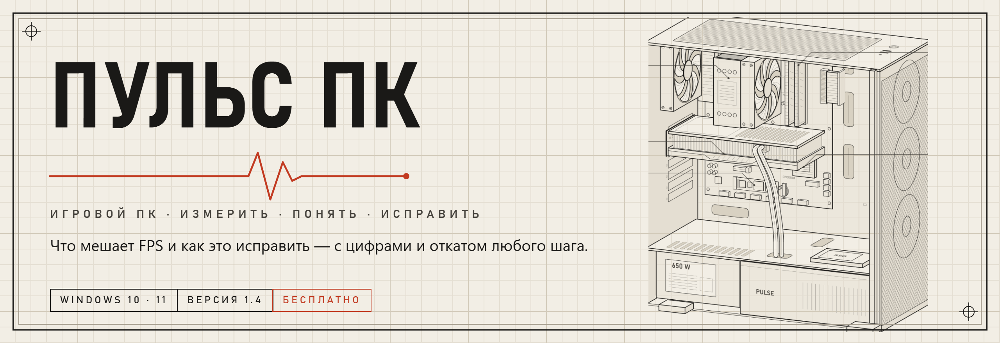
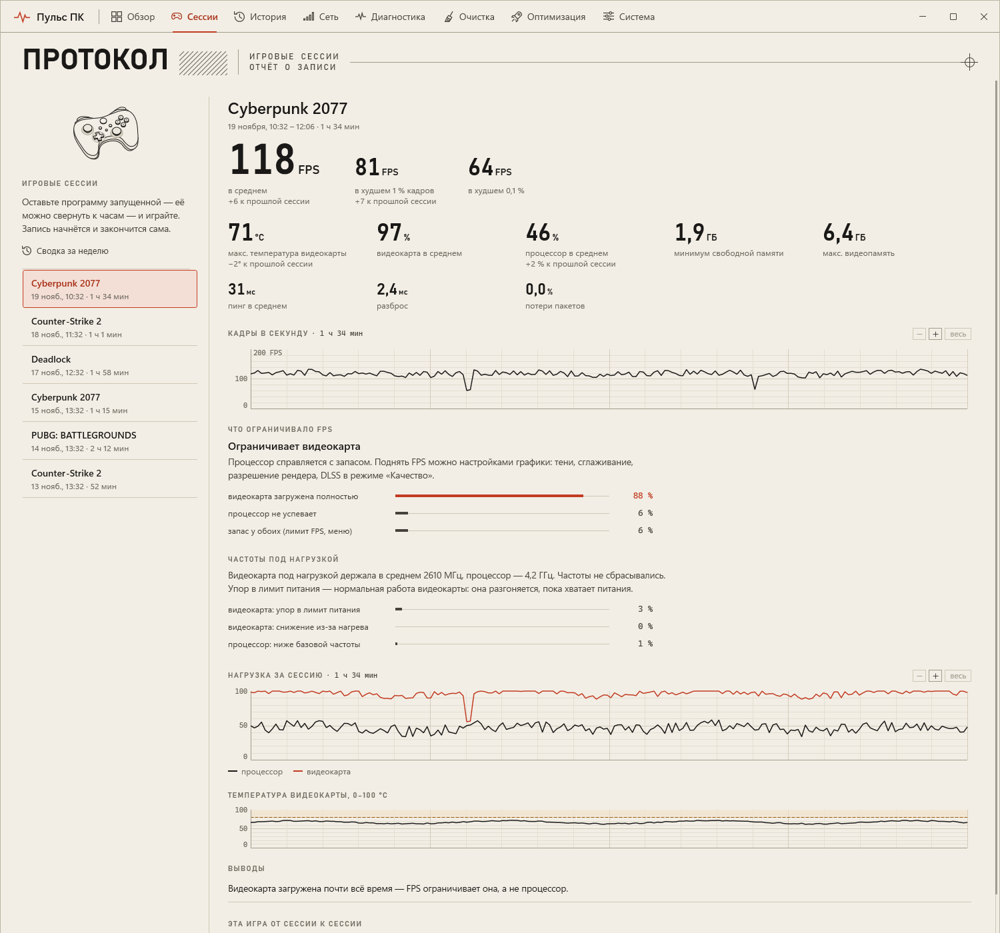
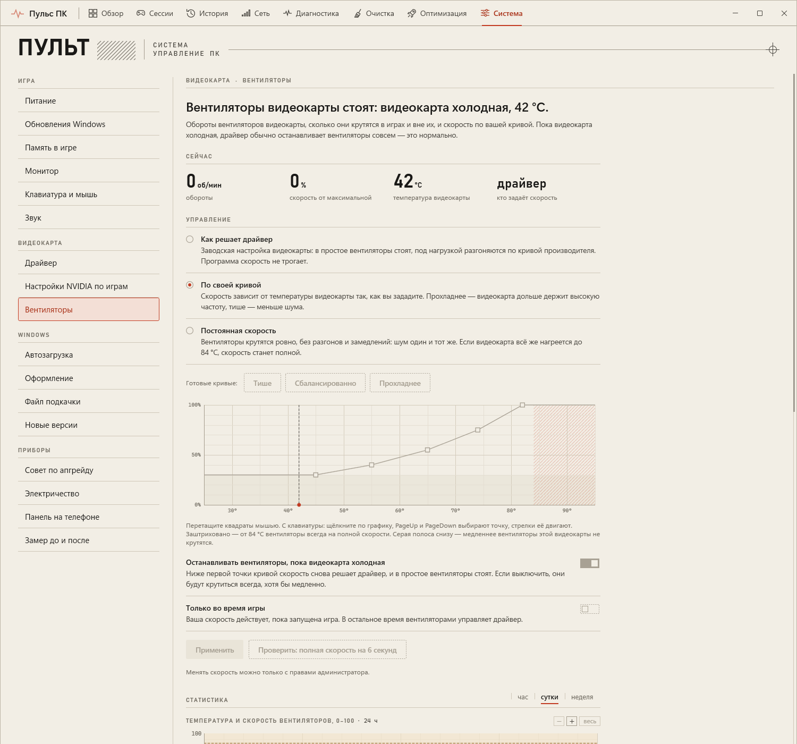
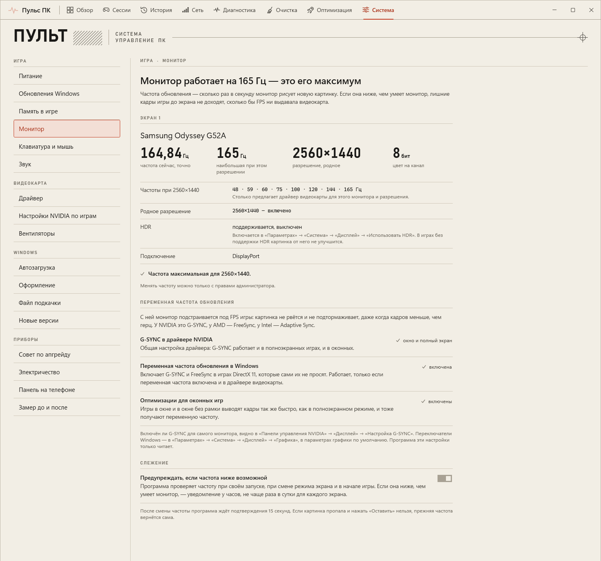
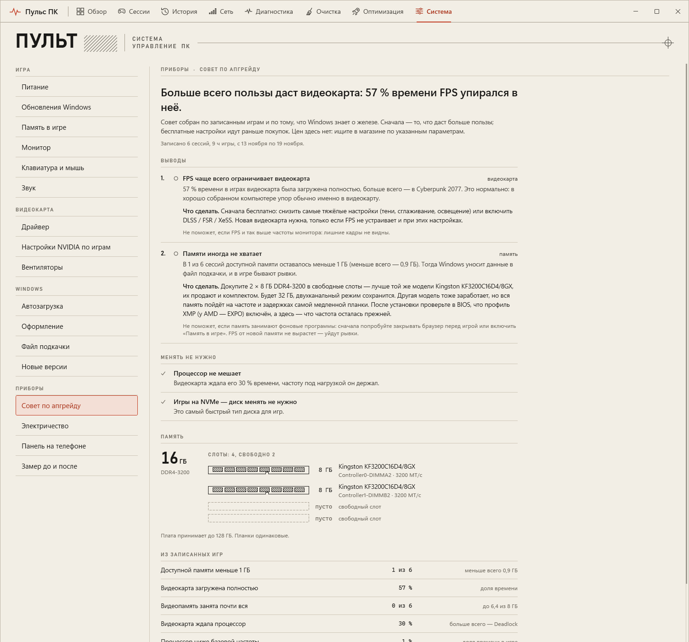
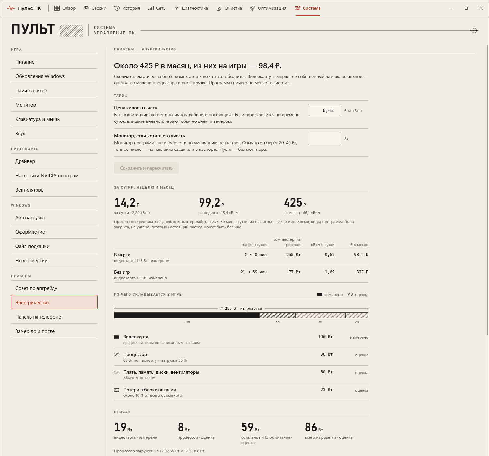

  
   
  <a href="https://github.com/Arman715/pulse-pc/raw/main/docs/PulsePC-video.mp4">▶&nbsp;Ролик со звуком</a> · MP4, 24&nbsp;секунды, 19,6&nbsp;МБ

  

  
  
  
  

<h3 align="center">
  <a href="../../releases/latest">⬇&nbsp;Скачать установщик</a>
</h3>

  Программа следит за компьютером, пока вы играете, и после игры объясняет простыми словами: 
  что ограничивало FPS, откуда взялись рывки и что с этим сделать. Каждое изменение можно отменить.

---

## Компьютер — как чертёж

Главный экран — чертёж вашего системного блока, нарисованный по тому, что стоит внутри: процессор, видеокарта, все планки памяти и все диски.
Нажмите на деталь — она разберётся на части, и у каждой будет подписано, как она работает сейчас.

- Загрузка, частоты, температура видеокарты и память — вживую.
- Здоровье дисков, ошибки драйвера, сбои Windows — на вкладке «Диагностика».
- Отчёт о том, сколько места можно освободить, и очистка с понятным списком.

 

## Отчёт после каждой игры

Запись начинается сама, когда запускается игра, и заканчивается, когда она закрыта. В отчёте:

| | |
|---|---|
| **FPS** | средний, худший 1 % и 0,1 % кадров, график всей сессии |
| **Что ограничивало FPS** | видеокарта, процессор или лимит — и что поможет именно в этом случае |
| **Просадки** | когда случились и почему: не хватило памяти, диск, сброс частоты, нагрев |
| **Сеть** | пинг до сервера игры, разброс и потери |
| **Сравнение** | та же игра от сессии к сессии |

## Настройки, которые раньше прятались по углам Windows

<table>
<tr>
<td width="50%"></td>
<td width="50%"></td>
</tr>
<tr>
<td><b>Вентиляторы видеокарты.</b> Своя кривая скорости, тише или прохладнее, статистика за неделю и напоминание почистить от пыли. От&nbsp;84&nbsp;°C — всегда полная скорость.</td>
<td><b>Монитор.</b> Работает ли он на своей частоте — 144 или 165&nbsp;Гц, а не на 60. G-SYNC, HDR, разъём. Если частота сбросится, программа предупредит.</td>
</tr>
<tr>
<td width="50%"></td>
<td width="50%"></td>
</tr>
<tr>
<td><b>Совет по апгрейду.</b> По вашим играм, а не по чужим тестам: что даст пользу, что докупить и что менять не нужно.</td>
<td><b>Электричество.</b> Сколько стоит час игры и месяц работы компьютера по вашему тарифу.</td>
</tr>
</table>

А ещё: схема питания на время игры, обновления Windows не мешают играм, память перед игрой, частота опроса мыши, звук, настройки NVIDIA по играм,
файл подкачки, автозагрузка, панель на телефоне в домашней сети и замер «до и после».

## Установка

1. Скачайте `PulsePC-Setup-<версия>.exe` из [последнего выпуска](../../releases/latest).
2. Запустите и нажмите «Установить». Программе нужны права администратора: без них Windows не даёт читать датчики и менять настройки.
3. Дальше «Пульс ПК» обновляется сам: «Система» → «Новые версии» → «Обновить».

> [!NOTE]
> Установщик не подписан сертификатом, поэтому SmartScreen может показать «Windows защитила ваш компьютер».
> Нажмите «Подробнее» → «Выполнить в любом случае». Контрольная сумма SHA-256 лежит рядом с установщиком в файле `.sha256`;
> при обновлении программа сверяет её сама.

## Частые вопросы

<b>Не забанят ли меня в игре?</b>

Программа ничего не рисует поверх игры и не встраивается в неё. FPS она считает официальным инструментом Intel PresentMon — так же,
как это делают CapFrameX и NVIDIA FrameView. В играх с античитом уровня ядра (VALORANT, League of Legends) запись кадров выключена совсем, на всякий случай.

<b>Что, если какая-то настройка сделает хуже?</b>

У каждого изменения есть кнопка «Вернуть как было»: программа сохраняет прежние значения перед тем, как что-то менять.
Настройки безопасности Windows — защитник, брандмауэр, SmartScreen, контроль учётных записей — программа не трогает вообще.

<b>Подойдёт ли моё железо?</b>

Да: видеокарты NVIDIA, AMD и Intel, процессоры Intel и AMD, ноутбуки и настольные компьютеры. Некоторые функции есть только у NVIDIA —
например, управление вентиляторами видеокарты и настройки драйвера по играм. Там, где функция недоступна, программа так и пишет и подсказывает, где это сделать.

<b>Что программа отправляет в интернет?</b>

Ничего о вас. Она спрашивает у NVIDIA номер последнего драйвера для вашей модели видеокарты и проверяет новые версии в этом репозитории. Всё остальное остаётся на компьютере.

---

Встроен <a href="https://github.com/GameTechDev/PresentMon">PresentMon</a> от Intel (лицензия MIT). Требуется Windows 10 или 11, 64 бита.
