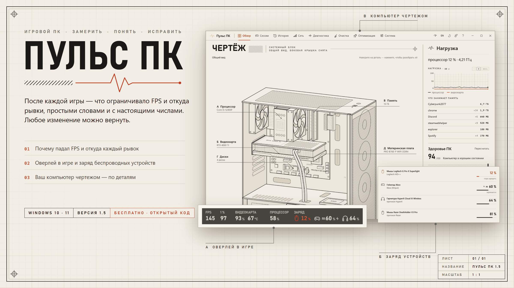
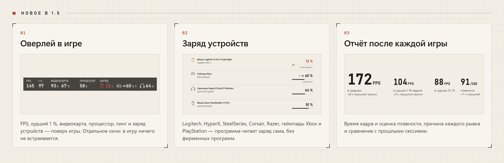
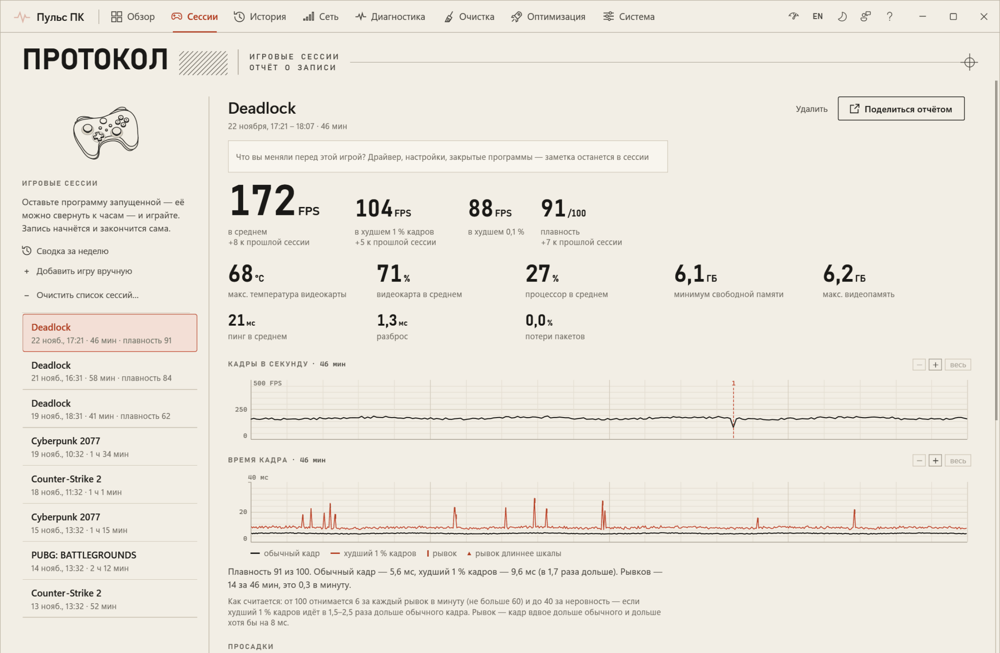
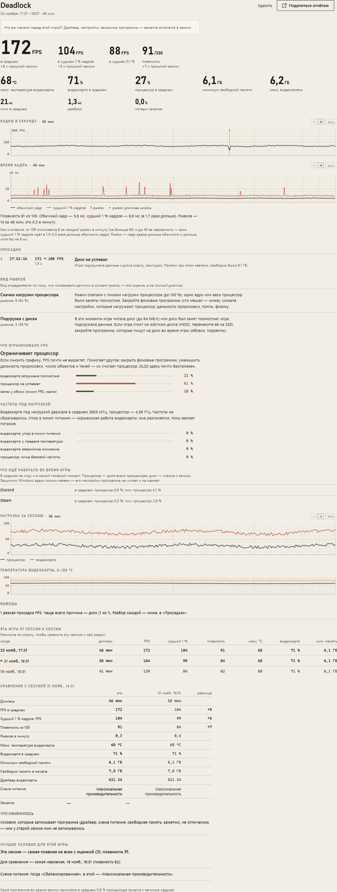
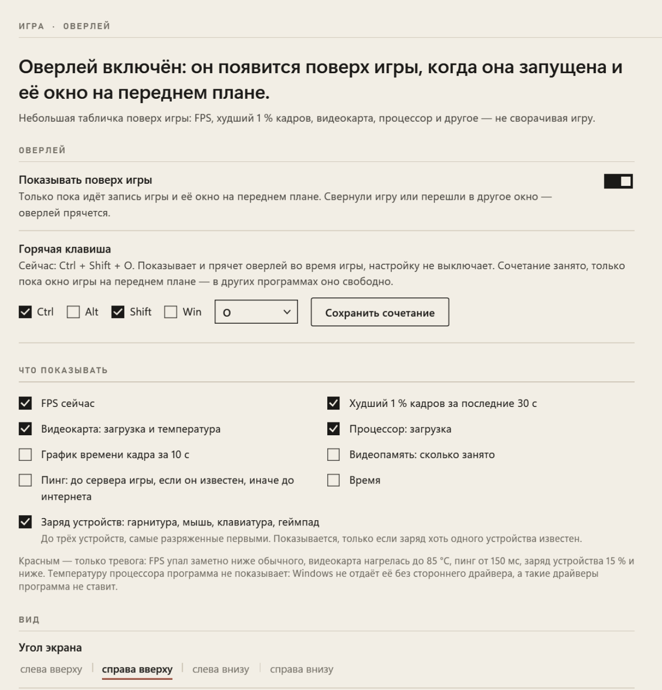
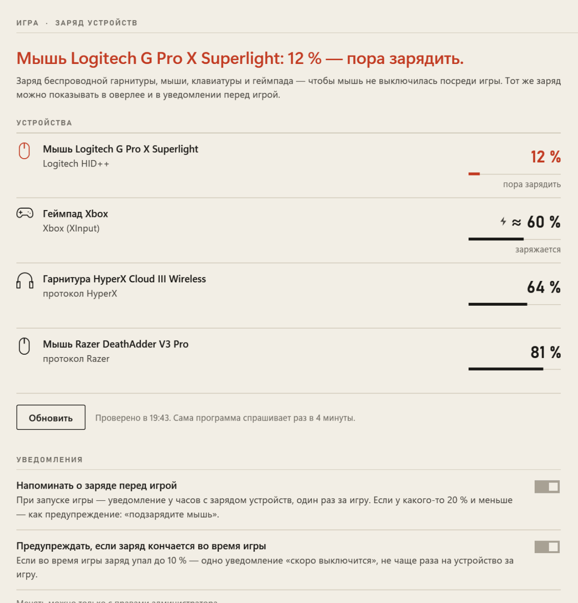
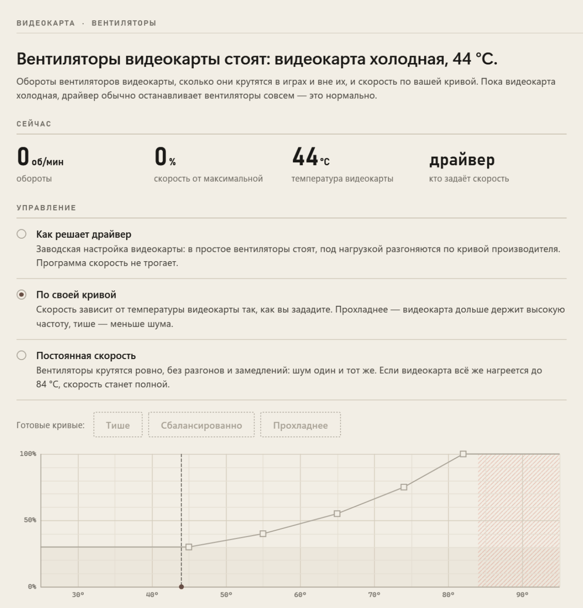
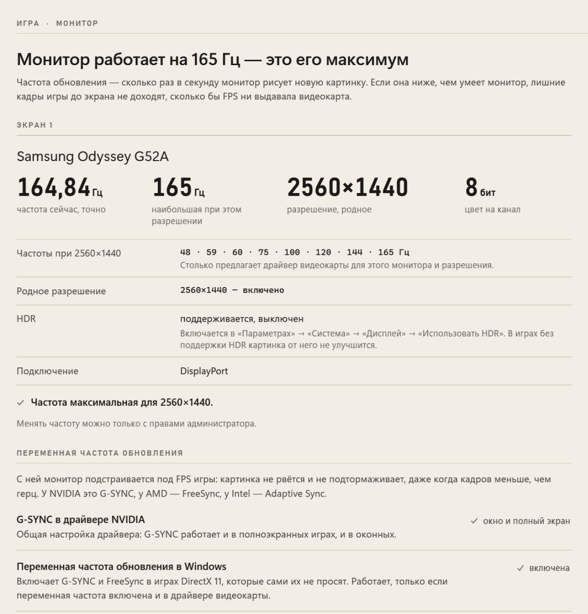
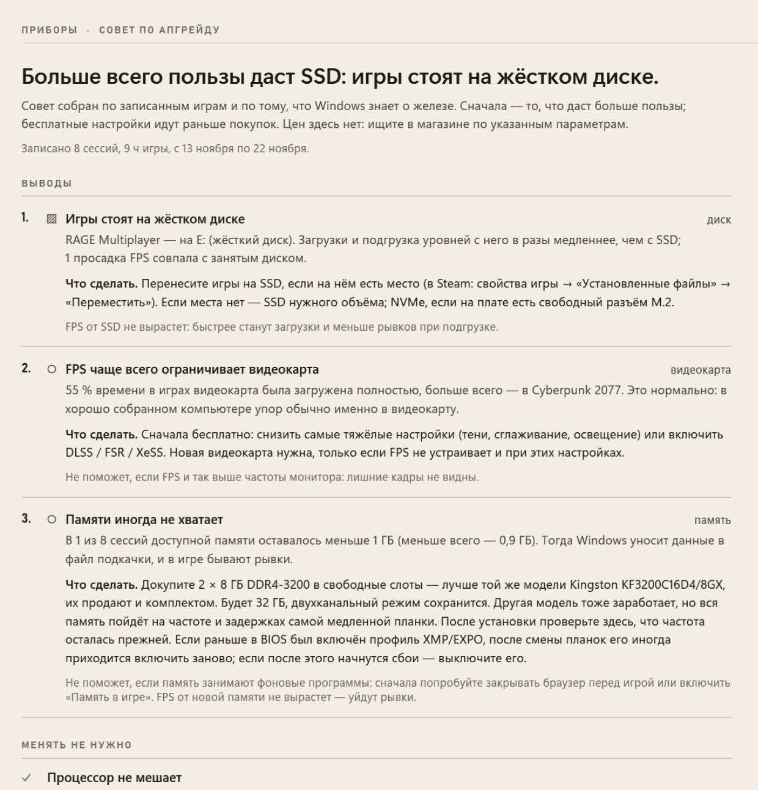
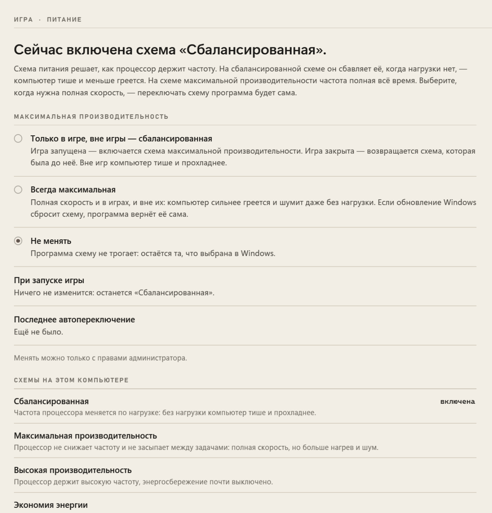

<p align="right"><a href="README.md">English</a>&nbsp;&nbsp;·&nbsp;&nbsp;<b>Русский</b></p>

<p align="center">
<picture>
  <source media="(prefers-color-scheme: dark)" srcset="docs/v15/ru/dark/hero.png">
  
</picture>
</p>

<p align="center">
  <a href="https://github.com/Arman715/pulse-pc/releases/latest"></a>
  <a href="https://github.com/Arman715/pulse-pc/releases"></a>
  
  
  <a href="LICENSE"></a>
  <a href="https://www.virustotal.com/gui/file/1933a3b8bbfa4cb3788fdfbc756eab515b4a77d8ea13cf932c262e659169b1bc"></a>
</p>

<h3 align="center">
  <a href="https://github.com/Arman715/pulse-pc/releases/latest">⬇&nbsp;&nbsp;Скачать для Windows</a>
  &nbsp;&nbsp;·&nbsp;&nbsp;
  <a href="docs/guide.md">Инструкция</a>
  &nbsp;&nbsp;·&nbsp;&nbsp;
  <a href="https://t.me/pulsepc_official">Telegram</a>
  &nbsp;&nbsp;·&nbsp;&nbsp;
  <a href="https://www.instagram.com/pulsepc_official/">Instagram</a>
</h3>

<p align="center">
  «Пульс ПК» следит за компьютером, пока вы играете, а после игры простыми словами говорит,<br>
  что ограничивало FPS, откуда взялся каждый рывок и что с этим сделать.<br>
  Любое изменение можно вернуть. Бесплатно, <a href="#открытый-исходный-код">с открытым кодом</a>, на русском и английском.
</p>

<br>

<picture>
  <source media="(prefers-color-scheme: dark)" srcset="docs/v15/ru/dark/new.png">
  
</picture>

**Ещё в 1.5:** осторожный режим для игр со строгим античитом (VALORANT, Call of Duty, Genshin Impact и другие) — запись кадров и сервера игры там выключена;
все игры находятся сами — из магазинов, из папок и по поведению; проверка памяти и XMP/EXPO с предупреждением о рисках, синие экраны простыми словами,
ошибки WHEA и вылеты игр; Wi‑Fi и пинг под нагрузкой; раздел **«Ноутбук»**; **«Почему тормозит прямо сейчас»**; **«Здоровье ПК»**; **«Установленные программы»**;
обновление без нажатия (по желанию) и переносная версия; у каждой проблемы из журналов Windows — **«Подробнее и что делать»**: записи простыми словами, план по шагам и кнопка, которая открывает ровно эти записи в «Просмотре событий».

## Отчёт после каждой игры

Запись начинается сама, когда запускается игра, и заканчивается, когда она закрыта. Окно можно закрыть — программа работает у часов.

<picture>
  <source media="(prefers-color-scheme: dark)" srcset="docs/v15/ru/dark/sessions.png">
  
</picture>

| | |
|---|---|
| **FPS и время кадра** | средний, худший 1 % и 0,1 % кадров, оценка плавности из 100 и каждый рывок на графике |
| **Откуда рывки** | у каждой просадки — причина: память, диск, нагрузка процессора, нагрев, питание — по датчикам в ту самую секунду |
| **Что ограничивало FPS** | видеокарта, процессор или лимит — и что поможет именно в этом случае |
| **Сеть** | пинг до сервера игры, разброс, потери и обрывы связи |
| **Сравнение** | эта сессия рядом с любой прошлой и условия, в которых игра шла плавнее всего |

<details>
<summary><b>Посмотреть отчёт целиком</b></summary>
<br>

<picture>
  <source media="(prefers-color-scheme: dark)" srcset="docs/v15/ru/dark/report.png">
  
</picture>
</details>

## Оверлей и заряд устройств

<table>
<tr>
<td width="50%"><picture>
  <source media="(prefers-color-scheme: dark)" srcset="docs/v15/ru/dark/overlay.png">
  
</picture></td>
<td width="50%"><picture>
  <source media="(prefers-color-scheme: dark)" srcset="docs/v15/ru/dark/battery.png">
  
</picture></td>
</tr>
<tr>
<td valign="top"><b>Оверлей.</b> Небольшая табличка поверх игры: FPS, худший 1 %, видеокарта, процессор, видеопамять, пинг, время и заряд устройств. Это отдельное окно — в игру ничего не встраивается. Виден в режимах «Без рамки» и «Полноэкранный в окне»; <kbd>Ctrl</kbd>+<kbd>Shift</kbd>+<kbd>O</kbd> прячет его.</td>
<td valign="top"><b>Заряд устройств.</b> Мыши, гарнитуры, клавиатуры и геймпады — Logitech, HyperX, SteelSeries, Corsair, Razer, Xbox, PlayStation, Bluetooth-устройства и другие. Программа сама читает заряд запросами чтения и перед игрой напомнит, если что-то скоро сядет.</td>
</tr>
</table>

## Начать за три шага

| № | Что сделать | Как |
|:-:|---|---|
| **1** | **Скачайте и установите** | [PulsePC-Setup.exe](https://github.com/Arman715/pulse-pc/releases/latest) → «Установить». Отметьте «Запускать вместе с Windows» — тогда ни одна игра не пропадёт. |
| **2** | **Просто играйте** | Программа сама заметит игру и начнёт запись. Окно можно закрыть — она работает у часов. |
| **3** | **Откройте отчёт** | После игры придёт уведомление «Сессия записана». Вкладка «Сессии» покажет FPS, рывки и их причины — и что с этим сделать. |

Подробно, с картинками и словарём терминов, — в **[инструкции](docs/guide.md)**. В самой программе справка открывается кнопкой **«?»** или клавишей **F1**.

### Кому пригодится

- **Игра лагает, а почему — непонятно.** Программа покажет, что упирается: видеокарта, процессор, память, диск или сеть.
- **Хотите выжать FPS, но боитесь «сломать Windows».** Каждая настройка объяснена, у каждой есть «Вернуть как было».
- **Думаете об апгрейде.** Совет строится по вашим играм: что купить, а что менять незачем.

## Настройки, которые раньше прятались по углам Windows

<table>
<tr>
<td width="50%"><picture>
  <source media="(prefers-color-scheme: dark)" srcset="docs/v15/ru/dark/fans.png">
  
</picture></td>
<td width="50%"><picture>
  <source media="(prefers-color-scheme: dark)" srcset="docs/v15/ru/dark/monitor.png">
  
</picture></td>
</tr>
<tr>
<td valign="top"><b>Вентиляторы видеокарты.</b> Своя кривая скорости, тише или прохладнее, статистика за неделю и напоминание почистить от пыли. От&nbsp;84&nbsp;°C — всегда полная скорость.</td>
<td valign="top"><b>Монитор.</b> Работает ли он на своей частоте — 144 или 165&nbsp;Гц, а не на 60. G-SYNC, HDR, разъём. Если частота сбросится, программа предупредит.</td>
</tr>
<tr>
<td width="50%"><picture>
  <source media="(prefers-color-scheme: dark)" srcset="docs/v15/ru/dark/upgrade.png">
  
</picture></td>
<td width="50%"><picture>
  <source media="(prefers-color-scheme: dark)" srcset="docs/v15/ru/dark/power.png">
  
</picture></td>
</tr>
<tr>
<td valign="top"><b>Совет по апгрейду.</b> По вашим играм, а не по чужим тестам: что даст пользу, что докупить и что менять не нужно.</td>
<td valign="top"><b>Питание.</b> Полная скорость — только пока вы играете: программа сама включает нужную схему питания и потом возвращает прежнюю.</td>
</tr>
</table>

А ещё: обновления Windows не мешают играм, память перед игрой, частота опроса мыши, звук, настройки NVIDIA по играм,
файл подкачки, автозагрузка, панель на телефоне в домашней сети и замер «до и после».

## Под вас

- **Русский и английский, светлая и тёмная тема** — маленькие кнопки «EN» и «луна» в заголовке окна. По умолчанию — как в Windows.
- **Окно под ваш экран:** от ноутбука 1366×768 до большого монитора; учитывается «Размер текста» Windows, а размер и место окна запоминаются.
- **Своя игра:** если программа не нашла игру сама, добавьте её файл .exe на вкладке «Сессии».
- **Сообщить о проблеме или оставить отзыв** — кнопка в заголовке окна: описание, снимки экрана и сведения о программе уходят письмом из вашей же почты.

Нравится программа? Поставьте ей ⭐ на GitHub — так её проще найти другим игрокам.

## Установка

1. Скачайте `PulsePC-Setup-<версия>.exe` из [последнего выпуска](https://github.com/Arman715/pulse-pc/releases/latest).
2. Запустите и нажмите «Установить». Программе нужны права администратора: без них Windows не даёт читать датчики и менять настройки.
3. Дальше «Пульс ПК» обновляется сам: «Система» → «Новые версии» → «Обновить» — или без нажатия, вне игры, если включить это там же.

Что делать дальше — в **[инструкции](docs/guide.md)**: первый запуск, как читать отчёт, подготовка к игре, очистка, все разделы «Системы».

> [!NOTE]
> Установщик не подписан сертификатом, поэтому SmartScreen может показать «Windows защитила ваш компьютер».
> Нажмите «Подробнее» → «Выполнить в любом случае». Контрольная сумма SHA-256 лежит рядом с установщиком в файле `.sha256`;
> при обновлении программа сверяет её сама.

## Проверено антивирусами

Установщик версии 1.5.0 проверен на VirusTotal: **ни один антивирус не нашёл угроз** — [открыть отчёт](https://www.virustotal.com/gui/file/1933a3b8bbfa4cb3788fdfbc756eab515b4a77d8ea13cf932c262e659169b1bc).

Убедиться, что у вас тот же самый файл, можно за секунду. В PowerShell, в папке со скачанным установщиком:

```powershell
Get-FileHash .\PulsePC-Setup-1.5.0.exe
```

Сумма должна совпасть с отчётом VirusTotal и с файлом `.sha256` в выпуске: `1933a3b8bbfa4cb3788fdfbc756eab515b4a77d8ea13cf932c262e659169b1bc`.

Что ещё говорит в пользу программы:

- **Весь код открыт** — папка [`src`](src). Любой может прочитать, что программа делает с системой, и собрать её сам.
- **Обновления подписаны ключом автора.** Программа ставит новую версию, только если подпись верна, — подменить обновление нельзя.
- **«Безопасность Windows» программа не трогает:** защитник, брандмауэр, SmartScreen и контроль учётных записей остаются как были.
- **О вас ничего не отправляется.** В интернет программа обращается только за номером свежего драйвера NVIDIA и за новыми версиями в этом репозитории.

## Частые вопросы

<details>
<summary><b>Не забанят ли меня в игре?</b></summary>

В игру программа ничего не встраивается. Оверлей (по желанию) — это отдельное окно программы поверх игры, а не вставка в игру.
FPS программа считает официальным инструментом Intel PresentMon — так же, как это делают CapFrameX и NVIDIA FrameView.
В играх со строгим античитом (VALORANT, Call of Duty, Genshin Impact и другие) включается осторожный режим: запись кадров и сервера игры выключена.
В играх с EasyAntiCheat и BattlEye запись по умолчанию полная, а осторожный режим можно включить для любой игры вручную.
</details>

<details>
<summary><b>Что, если какая-то настройка сделает хуже?</b></summary>

У каждого изменения есть кнопка «Вернуть как было»: программа сохраняет прежние значения перед тем, как что-то менять.
Настройки безопасности Windows — защитник, брандмауэр, SmartScreen, контроль учётных записей — программа не трогает вообще.
</details>

<details>
<summary><b>Подойдёт ли моё железо?</b></summary>

Да: видеокарты NVIDIA, AMD и Intel, процессоры Intel и AMD, ноутбуки и настольные компьютеры. Некоторые функции есть только у NVIDIA —
например, управление вентиляторами видеокарты и настройки драйвера по играм. Там, где функция недоступна, программа так и пишет и подсказывает, где это сделать.
</details>

<details>
<summary><b>Что программа отправляет в интернет?</b></summary>

Ничего о вас. Она спрашивает у NVIDIA номер последнего драйвера для вашей модели видеокарты и проверяет новые версии в этом репозитории. Всё остальное остаётся на компьютере.
Это можно проверить: весь код программы лежит в папке [`src`](src). Отчёт о проблеме или отзыв программа сама не отправляет — она открывает письмо в вашей почте, и вы видите, что в нём.
</details>

## Открытый исходный код

Весь код «Пульс ПК» лежит в папке [`src`](src): программа для Windows (C#, WPF, .NET 10) и панель для iPhone ([`src/ios/PulsePhone`](src/ios/PulsePhone), Swift).
Можно прочитать, что именно программа делает с системой, собрать её самому и предложить исправление.

**Собрать из исходников.** Нужны Windows 10/11 и [.NET 10 SDK](https://dotnet.microsoft.com/download/dotnet/10.0).

```powershell
git clone https://github.com/Arman715/pulse-pc.git
cd pulse-pc\src
.\build.ps1 -Preview   # версия для просмотра без прав администратора: ничего не меняет в системе
.\build.ps1            # полная версия в папку src\app (запускается с правами администратора)
```

Самопроверка кода (откат настроек, удаление файлов, разбор данных) запускается без изменений в системе: `PulsePC.exe --selftest`.

**Официальные выпуски** собираются скриптом [`build-release.ps1`](src/build-release.ps1) и подписываются ключом автора.
Программа устанавливает обновление, только если подпись верна, — поэтому копия, собранная кем-то другим, не сможет выдать себя за обновление «Пульс ПК».

**Нашли ошибку или есть идея?** Напишите в [Issues](https://github.com/Arman715/pulse-pc/issues) — приложите отчёт из «Система» → «Состояние программы» → «Скопировать отчёт».
Исправления присылайте через pull request: опишите, что меняется и как вы это проверили. Писать можно по-русски или по-английски.

**Лицензия — [GPL-3.0](LICENSE).** Код можно использовать, изменять и распространять, в том числе свои версии,
при условии что они тоже выходят под GPL-3.0 с открытым кодом и с указанием автора. Закрыть код в своей копии нельзя.

---

Новости, разборы «почему тормозит игра» и ответы на вопросы — в Telegram **[t.me/pulsepc_official](https://t.me/pulsepc_official)** и в Instagram **[@pulsepc_official](https://www.instagram.com/pulsepc_official/)**.

<sub>© 2026 Arman715. Код распространяется по лицензии <a href="LICENSE">GPL-3.0</a>.
Встроен <a href="https://github.com/GameTechDev/PresentMon">PresentMon</a> от Intel (лицензия MIT, текст — в <a href="src/third-party/PresentMon/LICENSE.txt">src/third-party/PresentMon</a>). Требуется Windows 10 или 11, 64 бита.</sub>
