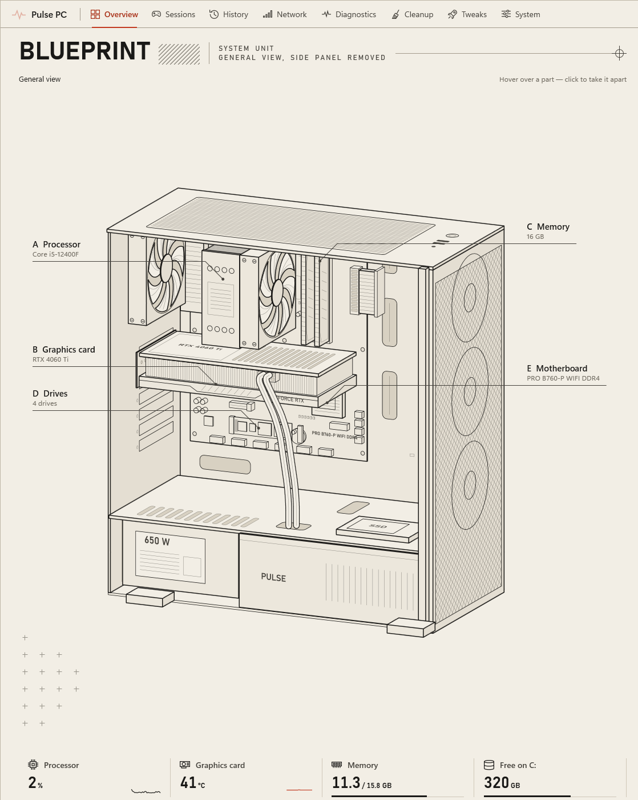
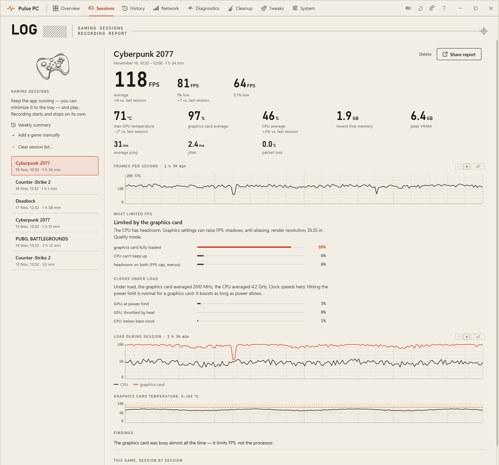
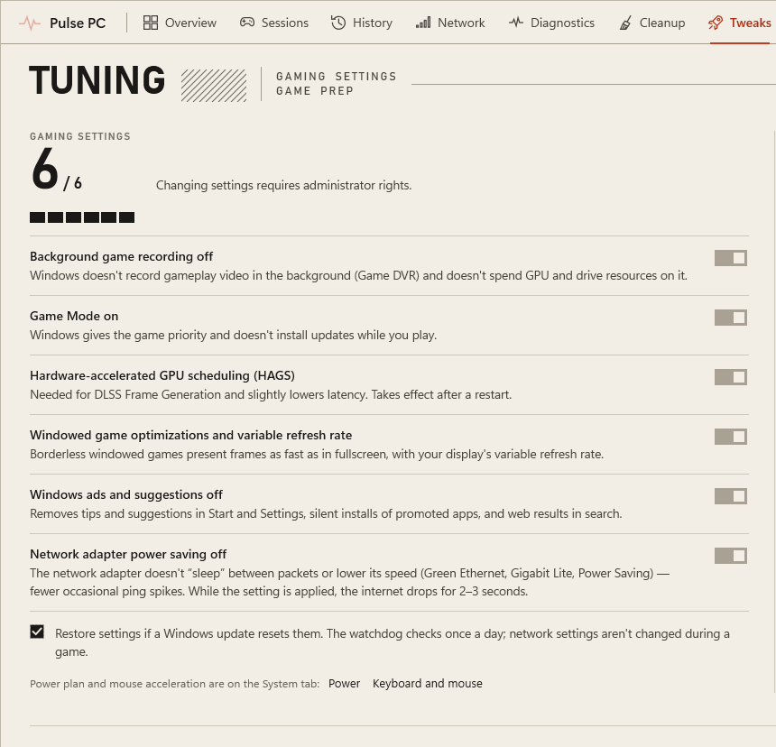
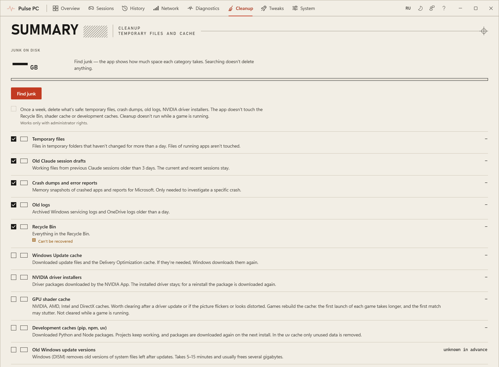

<a href="guide.md">Русский</a>&nbsp;&nbsp;·&nbsp;&nbsp;<b>English</b>

# How to use Pulse PC

A guide for people who have just installed the app. You don't have to read it in order — pick what you need.

> [!TIP]
> The same help is inside the app: the **?** button at the top of the window or **F1**. From every section there you can jump straight to the right tab.

**Contents**

1. [Installation](#1-installation)
2. [First launch](#2-first-launch)
3. [The tray icon](#3-the-tray-icon)
4. [Play and get a report](#4-play-and-get-a-report)
5. [How to read a report](#5-how-to-read-a-report)
6. [Get your PC ready for a game](#6-get-your-pc-ready-for-a-game)
7. [Free up disk space](#7-free-up-disk-space)
8. [Check that everything is fine](#8-check-that-everything-is-fine)
9. [The System tab](#9-the-system-tab)
10. [Updating and uninstalling](#10-updating-and-uninstalling)
11. [Glossary](#11-glossary)
12. [If something is wrong](#12-if-something-is-wrong)

---

## 1. Installation

1. Download `PulsePC-Setup-<version>.exe` from the [releases page](https://github.com/Arman715/pulse-pc/releases/latest).
2. Run it. If Windows shows a blue "Windows protected your PC" window, click **More info → Run anyway**.
   This happens with every app that doesn't have a paid publisher certificate.
3. Windows asks for permission to make changes — click **Yes**. Without administrator rights the app can't read the sensors or change settings.
4. In the installer, tick what you need and click **Install**:

   | Checkbox | What it does |
   |---|---|
   | Desktop shortcut | a Pulse PC icon on the desktop |
   | Launch after installation | the app opens right away |
   | Start with Windows, minimized to the tray | **we recommend it**: games are always recorded, even if you forgot to open the app |

## 2. First launch

On the first launch the app checks the system once: it reads the Windows logs for the past week and checks the drives, memory and graphics card.
It takes about a minute and **changes nothing**. At the end you get a list: what's fine, what's worth a look, and where to click for it.

Then **Overview** opens — a blueprint of your PC.

- Hover over a part and it lights up. Click it and the part comes apart, with labels.
- On the right — processor and graphics card load over the last minute, and the programs using the most memory.
- At the bottom — four key numbers: processor, graphics card, memory and free disk space.

The tabs at the top of the window:

| Tab | What for |
|---|---|
| **Overview** | what's inside your PC and how it's working right now |
| **Sessions** | a report on every game |
| **History** | how the PC worked over the last two days |
| **Network** | ping to the router and to the internet, and any packet loss |
| **Diagnostics** | crashes, drive errors and driver errors |
| **Cleanup** | what takes up space and what can be deleted |
| **Tweaks** | Windows settings for games, and getting ready for a game |
| **System** | everything else: power, display, fans, mouse, sound and so on |

**Language and theme.** The small **EN / RU** button and the moon in the title bar switch the language and the light/dark theme.
By default the app follows the Windows language and theme. The same settings are in **System** → **Language · Язык**.

## 3. The tray icon

The window's close button **doesn't quit** the app — it hides it in the tray (next to the clock), so it keeps recording games and warning you about problems.

Right-click the icon:

- **Open Pulse PC** — bring the window back (or just click the icon);
- **Show alerts** — notifications about overheating, low memory, settings that got reset;
- **Record FPS in games** — on by default;
- **Minimize to the tray on close** — untick it if you want the close button to quit the app completely;
- **Exit** — quit the app completely.

## 4. Play and get a report

You don't need to click anything.

1. Leave the app running — it can stay in the tray.
2. Start a game and play. The app recognizes the game and starts recording: a **● recording** line appears at the bottom of the window.
3. Close the game. A few seconds later a **Session recorded** notification appears next to the clock.
4. Open the **Sessions** tab — the report is there.

**The app didn't find your game?** On the **Sessions** tab click **Add a game manually** and pick the game's .exe file.
Recording will start the next time it launches; any other file from the game's folder is recognized too.

> [!NOTE]
> Sessions shorter than two minutes aren't saved — that's usually an accidental launch.
> Games with a strict anti-cheat (VALORANT, Call of Duty, Genshin Impact and others) get cautious mode: FPS and the game server aren't recorded — the app won't risk your account. In games with EasyAntiCheat and BattlEye recording is full by default; you can turn cautious mode on or off for any game.
> Everything else — temperature, load, ping — is recorded there too.

## 5. How to read a report

**The top row — FPS:**
- **average** — how many frames per second you usually had;
- **worst 1 % of frames** — how smooth the game was. If this number is much lower than the average, you felt stutters even with a good average.

**What limited FPS** — the most useful part of the report:

| What it says | What it means | What helps |
|---|---|---|
| Limited by the **graphics card** | it's working at its limit — that's normal | lower graphics settings, DLSS / FSR, render resolution |
| Limited by the **processor** | the graphics card is waiting for the processor | close background programs, lower view distance and object density; DLSS will barely help |
| **Headroom on both** | an FPS cap, V-Sync or a menu is the limit | all good — or raise the cap |

**Drops** — moments when FPS fell sharply, and the cause of each: low memory, the drive, clock throttling, heat.

Below that are graphs of the whole session, the ping to the game server and a table comparing **this game from session to session**: you can see whether things got better or worse after your changes.

**Deleting sessions.** The **Delete** button in a report removes that session; **Clear session list…** removes sessions older than 30 or 90 days, or all of them.

## 6. Get your PC ready for a game

The **Tweaks** tab.

**Gaming settings** — Windows switches that affect games: background recording, Game Mode, hardware-accelerated GPU scheduling and more.
Under each one it says what it does. Turn them on one at a time. Each can be switched back — Windows returns to the previous value.
A checkbox keeps watch so that a Windows update doesn't quietly reset them.

**Before playing** — on the right:
1. Tick the programs that can be closed (for example, a browser with a hundred tabs).
2. Pick the game from the list.
3. Click **Play** — the app closes what you ticked, frees up memory and starts the game.
   With "reopen closed programs after the game" ticked, everything opens again when you exit the game.

Discord, Steam, anti-cheats and Windows Security are never closed.

**Game graphics settings** — at the bottom. The app finds the settings files of installed games and suggests changes for your monitor
(for example, an FPS cap slightly below the refresh rate). Tick what you want and click **Apply selected** — a copy of the file is saved before any change.

## 7. Free up disk space

The **Cleanup** tab.

1. Click **Find junk** — the app counts how much space each category takes. Searching deletes nothing.
2. Untick what you want to keep.
3. Click **Clean**.

**Can't be recovered** is marked next to the Recycle Bin. The app doesn't touch files of running programs, personal documents or games.
The **Once a week, delete what's safe** checkbox only cleans temporary files, crash dumps, old logs and driver installers.

## 8. Check that everything is fine

The **Diagnostics** tab → **Run check**: Windows crashes over the past week, drive errors, graphics driver errors, memory.
Every finding is explained in plain words, with advice.

- **Mark as reviewed** — hide errors you already know about, so you only see new ones. The Windows logs themselves aren't deleted.
- **Full system check** — the same check as on the first launch.
- **The watchdog** checks once a day whether a Windows update reset your settings or new crashes appeared, and tells you in the tray.

## 9. The System tab

Individual settings live here. The list is on the left, the selected section on the right. Anything that changes the system changes only when you click a button, and every change can be undone.

| Section | What's there |
|---|---|
| **Power** | full performance only while gaming, and a quiet mode the rest of the time |
| **Windows Update** | so updates don't download or install in the middle of a match |
| **Memory in games** | how much memory is free and a **Free up memory** button, including automatically before a game |
| **Display** | whether the monitor runs at its real refresh rate (144, 165 Hz), G-SYNC / FreeSync, HDR |
| **Keyboard and mouse** | mouse acceleration, mouse polling rate, blocking the Windows key in games |
| **Sound** | quick switching between headphones and speakers |
| **Driver** | the graphics driver version and its crashes |
| **NVIDIA settings per game** | a driver profile for each game |
| **Fans** | graphics card fan speed, your own curve, statistics, a dust reminder |
| **Startup apps** | what starts together with Windows |
| **Visual effects** | unnecessary Windows animations and transparency |
| **Page file** | whether it's set up correctly |
| **Updates (app)** | the driver, the BIOS and the app itself |
| **Upgrade advice** | what will actually help in your games |
| **Electricity** | what an hour of gaming and a month of use cost: enter your own rate, time-of-day zones too (night, peak) |
| **Phone panel** | FPS and temperature on your phone's screen, on your home network |
| **Before/after test** | check whether your changes helped |

## 10. Updating and uninstalling

**Updating.** Once a day the app checks for a new version. If there is one, you get a notification in the tray and an
**Update** button in **System** → **Updates (app)**. Before installing, the app verifies the checksum and the author's signature of the downloaded file.

**Uninstalling.** Windows **Settings** → **Apps** → **Installed apps** → **Pulse PC** → **Uninstall**.
In the uninstaller you can tick "also delete the session history and settings". Windows settings you changed through the app
are best restored with the **Restore previous** buttons before uninstalling.

## 11. Glossary

| Word | In plain words |
|---|---|
| **FPS** | how many frames per second the game shows. More is smoother |
| **Worst 1 % of frames** | FPS in the heaviest moments. Shows stutters better than the average |
| **Drop** | a sharp fall in FPS for a second or two |
| **Ping** | how many milliseconds a signal takes to reach the server and come back. Lower is better |
| **Jitter** | how much the ping jumps around. High jitter feels like "teleporting" |
| **Packet loss** | packets that never arrived. Even 1 % is noticeable in a game |
| **Bottleneck** | the part that is working at its limit and keeps FPS from going higher |
| **Throttling** | the processor or graphics card slows down because of heat or power |
| **Page file** | space on the drive where Windows moves data when memory runs out. Many times slower than memory |

## 12. If something is wrong

- **The game isn't recorded.** Check that the app is running (the tray icon). Sessions shorter than two minutes aren't saved. If the game wasn't detected, add it manually on the **Sessions** tab.
- **The report has no FPS.** Turn on **Record FPS in games** in the tray icon menu. In games with a strict anti-cheat FPS isn't recorded on purpose (cautious mode); you can allow full recording in **Installed programs**.
- **Buttons are grey and say "administrator rights only".** Launch the app from the shortcut created by the installer — it asks for the rights itself.
- **You want everything back the way it was.** Every section where the app changed something has **Restore previous**.

Didn't find an answer? Click **Report a problem** in the title bar — the app prepares an email with screenshots and app details, and you send it from your own mailbox.
You can also open an [issue](https://github.com/Arman715/pulse-pc/issues) or send a direct message on Instagram [@pulsepc_official](https://www.instagram.com/pulsepc_official/).
