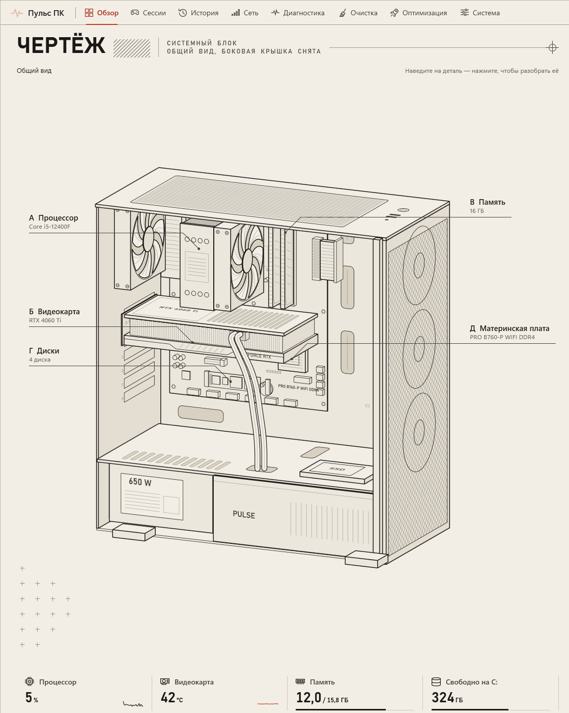
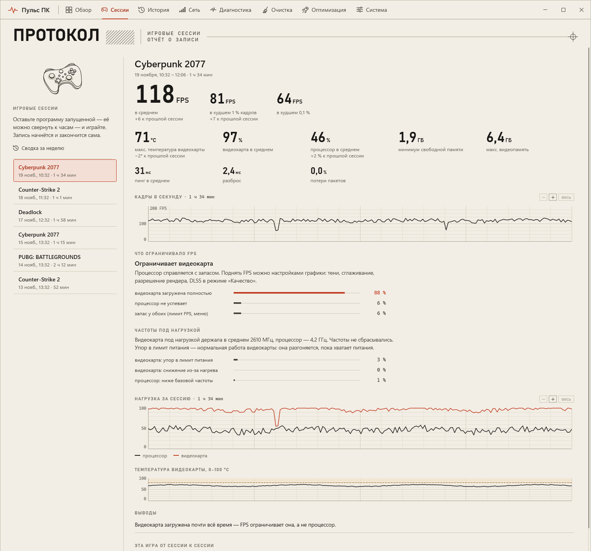
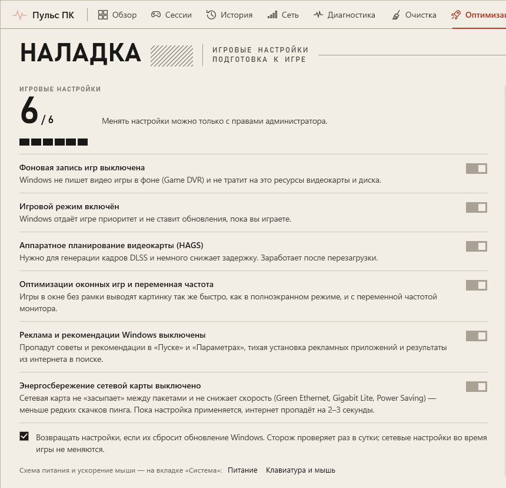
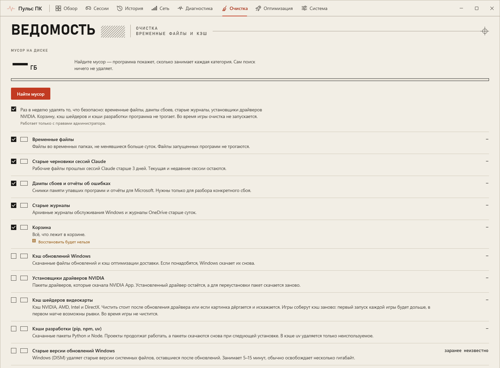

<b>Русский</b>&nbsp;&nbsp;·&nbsp;&nbsp;<a href="guide.en.md">English</a>

# Как пользоваться «Пульс ПК»

Инструкция для тех, кто только что поставил программу. Читать по порядку не обязательно — выберите, что нужно.

> [!TIP]
> Та же справка есть в самой программе: кнопка **«?»** вверху окна или клавиша **F1**. Там из каждого раздела можно сразу перейти в нужную вкладку.

**Содержание**

1. [Установка](#1-установка)
2. [Первый запуск](#2-первый-запуск)
3. [Значок у часов](#3-значок-у-часов)
4. [Сыграть и получить отчёт](#4-сыграть-и-получить-отчёт)
5. [Как читать отчёт](#5-как-читать-отчёт)
6. [Подготовить компьютер к игре](#6-подготовить-компьютер-к-игре)
7. [Освободить место на диске](#7-освободить-место-на-диске)
8. [Проверить, всё ли в порядке](#8-проверить-всё-ли-в-порядке)
9. [Вкладка «Система»](#9-вкладка-система)
10. [Обновление и удаление](#10-обновление-и-удаление)
11. [Словарь](#11-словарь)
12. [Если что-то не так](#12-если-что-то-не-так)

---

## 1. Установка

1. Скачайте `PulsePC-Setup-<версия>.exe` со [страницы выпусков](https://github.com/Arman715/pulse-pc/releases/latest).
2. Запустите файл. Если Windows покажет синее окно «Windows защитила ваш компьютер» — нажмите **«Подробнее» → «Выполнить в любом случае»**.
   Так бывает со всеми программами без платного сертификата издателя.
3. Windows спросит разрешение на изменения — нажмите **«Да»**. Без прав администратора программа не может читать датчики и менять настройки.
4. В окне установки отметьте нужное и нажмите **«Установить»**:

   | Галочка | Что делает |
   |---|---|
   | Ярлык на рабочем столе | значок «Пульс ПК» на рабочем столе |
   | Запустить после установки | программа откроется сразу |
   | Запускать вместе с Windows, свёрнутой к часам | **советуем включить**: тогда игры записываются всегда, даже если вы забыли открыть программу |

## 2. Первый запуск

При первом запуске программа один раз осматривает систему: читает журналы Windows за неделю, проверяет диски, память и видеокарту.
Это занимает около минуты и **ничего не меняет**. В конце будет список: что в порядке, на что стоит взглянуть и куда для этого нажать.

Дальше откроется **«Обзор»** — чертёж вашего системного блока.

- Наведите мышь на деталь — она подсветится. Нажмите — деталь разберётся на части с подписями.
- Справа — загрузка процессора и видеокарты за последнюю минуту и программы, которые занимают больше всего памяти.
- Внизу — четыре главных числа: процессор, видеокарта, память и свободное место на диске.

Вкладки вверху окна:

| Вкладка | Зачем |
|---|---|
| **Обзор** | что внутри компьютера и как он работает прямо сейчас |
| **Сессии** | отчёты о каждой игре |
| **История** | как компьютер работал последние двое суток |
| **Сеть** | пинг до роутера и до интернета, есть ли потери |
| **Диагностика** | сбои, ошибки дисков и драйвера |
| **Очистка** | что занимает место и что можно удалить |
| **Оптимизация** | настройки Windows для игр и подготовка к игре |
| **Система** | всё остальное: питание, монитор, вентиляторы, мышь, звук и т. д. |

**Язык и тема.** Маленькие кнопки **EN / RU** и «луна» в заголовке окна переключают язык и светлую или тёмную тему.
По умолчанию программа берёт язык и тему Windows. Те же настройки — в **«Система» → «Язык · Language»**.

## 3. Значок у часов

Крестик окна **не закрывает** программу, а прячет её к часам — так она продолжает записывать игры и предупреждать о проблемах.

Нажмите на значок правой кнопкой мыши:

- **Открыть Пульс ПК** — вернуть окно (или просто щёлкните по значку);
- **Показывать предупреждения** — уведомления о перегреве, нехватке памяти, сброшенных настройках;
- **Записывать FPS в играх** — включено по умолчанию;
- **При закрытии сворачивать к часам** — снимите галочку, если хотите, чтобы крестик закрывал программу совсем;
- **Выход** — закрыть программу полностью.

## 4. Сыграть и получить отчёт

Ничего нажимать не нужно.

1. Оставьте программу запущенной — можно свёрнутой к часам.
2. Запустите игру и играйте. Программа сама узнает игру и начнёт запись: внизу окна появится строка **«● запись»**.
3. Закройте игру. Через несколько секунд у часов появится уведомление **«Сессия записана»**.
4. Откройте вкладку **«Сессии»** — там отчёт.

**Программа не нашла вашу игру?** На вкладке **«Сессии»** нажмите **«Добавить игру вручную»** и укажите её файл .exe.
Запись начнётся при следующем запуске; узнаётся и любой другой файл из папки игры.

> [!NOTE]
> Сессии короче двух минут не сохраняются — это обычно случайный запуск.
> В VALORANT и League of Legends FPS не записывается: у их античитов доступ к уровню ядра, и программа не рискует вашим аккаунтом.
> Остальное — температура, загрузка, пинг — записывается и там.

## 5. Как читать отчёт

**Верхний ряд — FPS:**
- **в среднем** — сколько кадров в секунду было обычно;
- **в худшем 1 % кадров** — насколько плавно шла игра. Если это число намного меньше среднего, вы чувствовали рывки, даже при хорошем среднем.

**«Что ограничивало FPS»** — самое полезное место отчёта:

| Что написано | Что это значит | Что поможет |
|---|---|---|
| Ограничивает **видеокарта** | она работает на пределе — это нормально | графика пониже, DLSS / FSR, разрешение рендера |
| Ограничивает **процессор** | видеокарта ждёт процессор | закрыть фоновые программы, уменьшить дальность прорисовки и число объектов; DLSS почти не поможет |
| **Запас у обоих** | упор в лимит FPS, вертикальную синхронизацию или меню | всё в порядке или поднять лимит |

**Просадки** — моменты, когда FPS резко падал, и причина каждой: не хватило памяти, диск, сброс частоты, нагрев.

Ниже — графики всей сессии, пинг до сервера игры и таблица **«Эта игра от сессии к сессии»**: видно, стало лучше или хуже после изменений.

**Удалить сессии.** Кнопка **«Удалить»** в отчёте убирает одну сессию, **«Очистить список сессий…»** — старше 30 или 90 дней либо все.

## 6. Подготовить компьютер к игре

Вкладка **«Оптимизация»**.

**Игровые настройки** — переключатели Windows, которые влияют на игры: фоновая запись, игровой режим, планирование видеокарты и другие.
Под каждым написано, что он делает. Включайте по одному. Каждый можно выключить обратно — Windows вернётся к прежнему значению.
Галочка **«Возвращать настройки…»** следит, чтобы обновление Windows не сбросило их тихо.

**Перед игрой** — справа:
1. Отметьте программы, которые можно закрыть (например, браузер с сотней вкладок).
2. Выберите игру в списке.
3. Нажмите **«Играть»** — программа закроет отмеченное, освободит память и запустит игру.
   С галочкой «после игры снова открыть закрытые программы» всё откроется обратно, когда вы выйдете из игры.

Discord, Steam, античиты и «Безопасность Windows» не закрываются никогда.

**Настройки графики игр** — внизу. Программа находит файлы настроек установленных игр и предлагает изменения под ваш монитор
(например, лимит FPS чуть ниже частоты экрана). Отметьте нужное и нажмите **«Применить отмеченные»** — перед изменением сохраняется копия файла.

## 7. Освободить место на диске

Вкладка **«Очистка»**.

1. Нажмите **«Найти мусор»** — программа посчитает, сколько занимает каждая категория. Поиск ничего не удаляет.
2. Снимите галочки с того, что хотите оставить.
3. Нажмите **«Очистить»**.

Пометка **«Восстановить будет нельзя»** стоит у корзины. Файлы запущенных программ, личные документы и игры программа не трогает.
Галочка **«Раз в неделю удалять то, что безопасно»** чистит только временные файлы, дампы сбоев, старые журналы и установщики драйверов.

## 8. Проверить, всё ли в порядке

Вкладка **«Диагностика»** → **«Запустить проверку»**: сбои Windows за неделю, ошибки дисков, ошибки драйвера видеокарты, память.
Каждая находка объяснена простыми словами, с советом.

- **«Отметить как просмотренные»** — убрать уже известные ошибки, чтобы видеть только новые. Журналы Windows при этом не удаляются.
- **«Осмотр всей системы»** — тот же осмотр, что при первом запуске.
- **Сторож** раз в сутки сам проверяет, не сбросило ли обновление Windows ваши настройки и не появилось ли новых сбоев, и сообщает у часов.

## 9. Вкладка «Система»

Здесь собраны отдельные настройки. Слева список, справа выбранный раздел. Всё, что меняет систему, меняется по кнопке, и у каждого изменения есть возврат.

| Раздел | Что там |
|---|---|
| **Питание** | полная производительность только на время игры, а вне игры — тихий режим |
| **Обновления Windows** | чтобы обновления не качались и не ставились посреди матча |
| **Память в игре** | сколько памяти свободно и кнопка «Освободить память», в том числе автоматически перед игрой |
| **Монитор** | работает ли монитор на своей частоте (144, 165 Гц), G-SYNC / FreeSync, HDR |
| **Клавиатура и мышь** | ускорение мыши, частота опроса мыши, блокировка клавиши Win в игре |
| **Звук** | быстрое переключение наушников и колонок |
| **Драйвер** | версия драйвера видеокарты и его сбои |
| **Настройки видеокарты по играм** | профиль драйвера для каждой игры (у NVIDIA) |
| **Вентиляторы** | скорость вентиляторов видеокарты, своя кривая, статистика, напоминание о пыли |
| **Автозагрузка** | что запускается вместе с Windows |
| **Оформление** | лишние анимации и прозрачность Windows |
| **Файл подкачки** | правильно ли он настроен |
| **Новые версии** | драйвер, BIOS и сама программа |
| **Совет по апгрейду** | что даст пользу именно в ваших играх |
| **Электричество** | сколько стоит час игры и месяц работы — впишите свой тариф |
| **Панель на телефоне** | FPS и температура на экране телефона в домашней сети |
| **Замер до и после** | проверить, помогли ли изменения |

## 10. Обновление и удаление

**Обновление.** Программа раз в сутки проверяет, нет ли новой версии. Если есть — уведомление у часов и кнопка
**«Обновить»** в разделе **«Система» → «Новые версии»**. Перед установкой программа сверяет контрольную сумму и подпись автора у скачанного файла.

**Удаление.** «Параметры» Windows → **«Приложения» → «Установленные приложения» → «Пульс ПК» → «Удалить»**.
В окне удаления можно отметить **«Удалить заодно историю сессий и настройки»**. Настройки Windows, которые вы меняли через программу,
лучше вернуть кнопками «Вернуть как было» до удаления.

## 11. Словарь

| Слово | Простыми словами |
|---|---|
| **FPS** | сколько кадров в секунду показывает игра. Больше — плавнее |
| **Худший 1 % кадров** | FPS в самые тяжёлые моменты. Показывает рывки лучше, чем среднее |
| **Просадка** | резкое падение FPS на секунду-другую |
| **Пинг** | сколько миллисекунд идёт сигнал до сервера и обратно. Меньше — лучше |
| **Разброс** | насколько пинг скачет. Большой разброс ощущается как «телепорты» |
| **Потери** | пакеты, которые не дошли. Даже 1 % заметен в игре |
| **Упор** | деталь, которая работает на пределе и не даёт FPS вырасти |
| **Сброс частоты** | процессор или видеокарта замедляются из-за нагрева или питания |
| **Файл подкачки** | место на диске, куда Windows уносит данные, когда не хватает памяти. Медленнее памяти в разы |

## 12. Если что-то не так

- **Игра не записывается.** Проверьте, что программа запущена (значок у часов). Сессии короче двух минут не сохраняются. Если игра не определилась — добавьте её вручную на вкладке «Сессии».
- **В отчёте нет FPS.** Включите «Записывать FPS в играх» в меню значка. В VALORANT и LoL FPS не пишется намеренно.
- **Кнопки серые, написано «только с правами администратора».** Запускайте программу ярлыком из установки — он сам просит права.
- **Хочется вернуть всё как было.** В каждом разделе, где программа что-то меняла, есть «Вернуть как было».

Не нашли ответ — нажмите **«Сообщить о проблеме»** в заголовке окна: программа подготовит письмо со снимками экрана и сведениями о программе, а отправите его вы из своей почты.
Ещё можно написать в [Issues](https://github.com/Arman715/pulse-pc/issues) или в директ Instagram [@pulsepc_official](https://www.instagram.com/pulsepc_official/).
